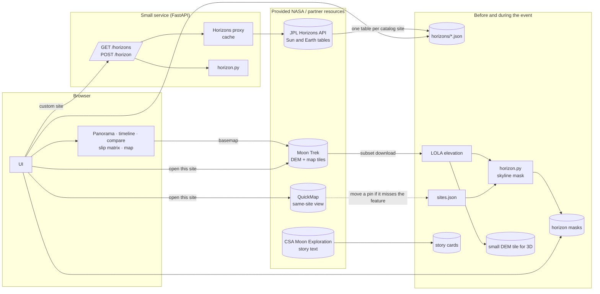

# Lunar Skyline — Design Document

> NASA Space Apps Challenge 2026 · *Lunar Landing Site Navigator*
>
> A simple web app on top of NASA's existing tools. A scientist, an engineer, and a manager can each answer the same two questions for a landing site and a date: **"Will we have power?"** and **"Can we talk to Earth?"** The first screen says it in a sentence. The picture shows why. The numbers are one click away, and they come from Horizons, Moon Trek, and QuickMap.

---

## 1. Problem framing

### 1.1 What the challenge actually asks for

| Challenge objective | How Lunar Skyline answers it |
|---|---|
| Interactive site selection & comparison | Curated site catalog + custom lat/lon + click-on-map; up to 4 pinned **Scenarios** side-by-side |
| Date & time flexibility | Landing date/time + mission duration, a timeline scrubber, and a **Slip Matrix** (sites × dates) |
| Sun & Earth position vs horizon | **Skyline Panorama**: 360° terrain silhouette with Sun and Earth discs and their tracks |
| Power & communication assessment | Solar elevation, visible disc fraction, panel power, % sunlit, longest night, Earth-visibility windows, **time to sunset / Earthset** countdowns |
| Multiple visualization approaches | Panorama, polar sky plot, Gantt timeline, elevation charts, polar map with heatmaps, 3D terrain with live shadows |
| Temporal dynamics | Animated playback over the mission window, a lunar day, or a lunar "season" |
| Accessibility across skill levels | **One screen for everyone.** A sentence and a picture first. Engineers and scientists open the details. A short tour explains the south pole for anyone who wants the lesson |

### 1.2 Users

The same screen serves all of them. Nobody picks a "mode" to get in. Detail is folded away until someone asks for it.

1. **Manager or other non-specialist.** Needs a decision, not a tool. "This date does not work. The next one that does is 28 March. Nobile Rim 1 works on the original date." They should reach that without learning azimuth, elevation, or what a DEM is.
2. **Engineer.** Needs the worst case when the date or the site moves: longest darkness, a communications gap at landing, time to sunset and Earthset. Those numbers sit behind "Show the numbers," and they trace back to a Horizons table and a Moon Trek horizon.
3. **Scientist.** Cares about the site for its science and needs to see what that site costs the mission. The same comparison answers "this crater is interesting, and it is in shadow for nine days."
4. **Educator, student, or the public.** Uses the same picture. A short tour, "Why is the south pole hard?", narrates it. The tour is optional and does not replace the decision screen.

### 1.3 Core insight we want users to *feel*

At the south pole the Sun never rises more than about **1.5°** above the mathematical horizon, because the Moon's spin axis is tilted only 1.54° to the ecliptic (Earth's is 23.4°). The Sun skims the horizon and circles the sky once per **29.5-day synodic month**. A ridge a few hundred metres high, kilometres away, can decide between continuous power and two weeks of darkness. Earth hangs low over the nearside horizon and rocks up and down by about ±6.7° (libration), so it rises and sets roughly every 27.2 days. **Location changes of a few hundred metres, or date changes of a few days, flip a site from great to unusable.** Every view in the app is built to make that obvious.

### 1.4 Two layers

The hackathon's main goal is a **simplified experience**. Scientists, engineers, and non-technical people such as managers should all be able to judge a landing site without first learning QuickMap, Moon Trek, or Horizons.

Those tools are the **bottom layer**. They already know the Sun, the Earth, and the terrain. Lunar Skyline does not replace them and does not ask the user to operate them. It asks them for data, then shows one picture and one sentence.

```
┌─────────────────────────────────────────────────────────┐
│  Lunar Skyline — the only thing most users see          │
│  A named site, a date, a sentence, a skyline, a yes/no  │
│  "Show the numbers" and "See the NASA source" on demand │
└─────────────────────────── ▲ ───────────────────────────┘
                             │  we add: skyline, countdowns,
                             │  comparison, plain-language score
┌────────────────────────────┴────────────────────────────┐
│  Bottom layer — NASA and partner tools, not rebuilt     │
│  Horizons · Moon Trek · QuickMap · CSA Moon Exploration │
└─────────────────────────────────────────────────────────┘
```

The goal for the weekend is that this top layer feels obvious. Technical accuracy matters, and it is not the thing we spend the weekend chasing. A few seconds of waiting on a NASA service is acceptable. A screen full of angles, or a tool that never gets to the comparison story, is not.

**Use the provided resources for anything they already compute or display.** JPL Horizons, QuickMap, Moon Trek, and the CSA Moon Exploration portal stay underneath. The user meets them as "Sun and Earth positions" and "the map," with a link for anyone who wants the original tool.

**Replicate a resource only when that replication is what makes the experience work.** The bar is: the resource cannot answer this interactively, and the copy is small. Interpolating a Horizons table so the playhead moves smoothly clears that bar. Rebuilding Horizons with SPICE does not.

**Add our own pieces freely when they are the product.** The skyline, the countdowns, the side-by-side scenarios, the slip matrix, and the plain-language score are ours. The resources do not offer that comparison.

| Resource | What we take from it | What we add on top |
|---|---|---|
| **JPL Horizons** | Every Sun and Earth azimuth, elevation, disc size, and Earth lit-fraction the user sees. One request per site returns the whole window. Catalog sites are fetched ahead of time and cached. A custom site shows "Asking JPL Horizons…" and then uses that table. | Smooth interpolation between samples, then the comparison of those positions with the local terrain |
| **Moon Trek** | The elevation model for the south pole (subset download) and the shaded-relief map tiles. "Open in Moon Trek" for the same spot. | The horizon silhouette, computed from that elevation model, because Trek does not return one for an arbitrary point |
| **QuickMap** | The visual check and the terrain browser. Every scenario opens the same site, zoom, and layers in QuickMap without retyping coordinates. Site coordinates are taken from what QuickMap and the mission pages show. | Nothing that QuickMap already draws. We do not rebuild its globe |
| **CSA Moon Exploration** | Wording, links, and mission context for Explore mode and one mission preset, copied from the live portal at submission time | The same Sun and Earth views, applied to those missions |

Each scenario footer names the source in plain language: "Sun and Earth from JPL Horizons, queried 14 Nov 2026" and "Horizon from Moon Trek LOLA elevation." Buttons open that site in QuickMap and Moon Trek.

> **Caveat for the team.** The exact Horizons parameters, Moon Trek endpoints, and QuickMap URL parameters below come from memory of their public docs. Confirm them in the first hour (§8) before building on them. QuickMap is a web app, not a calculation API. Use it by linking and checking, not by pretending it returns a time series.

---

## 2. Science & computation model

### 2.1 What we take as given

| Item | Source | Notes |
|---|---|---|
| Sun and Earth azimuth, elevation, angular size, Earth lit fraction | JPL Horizons, observer on the Moon (`coord@301`), airless apparent position | This is the position relative to the flat geometric horizon. Horizons already includes light-time, aberration, parallax, and libration. We display it in UTC, rounded to 0.1° |
| Observer height | Passed to Horizons as the site altitude plus the mast height | Raising the mast still changes the **terrain** horizon, which Horizons does not know |
| Elevation model and map picture | Moon Trek subset of the LOLA south-polar DEM, plus Trek shaded-relief tiles | PDS / GSFC archives are the backup if a Trek download is awkward |
| Site context and imagery | QuickMap, opened on the same coordinates | Used to confirm we are on the intended ridge or crater |
| Mission story | CSA Moon Exploration portal | Text and links only |

Coordinates for terrain stay in the Mean-Earth frame that LOLA, Moon Trek, and QuickMap use. We do not run a second ephemeris to check that frame. If a catalog pin lands on the wrong feature in QuickMap, we move the pin.

### 2.2 Sun and Earth positions come from Horizons

The Horizons API (`https://ssd.jpl.nasa.gov/api/horizons.api`) is the ephemeris. A small backend proxy caches responses, makes one upstream call at a time, and returns the query URL so a judge can repeat it.

```
COMMAND      = '10' (Sun) | '399' (Earth)
CENTER       = 'coord@301'
COORD_TYPE   = 'GEODETIC'
SITE_COORD   = 'lon_deg,lat_deg,alt_km'         (east longitude)
EPHEM_TYPE   = 'OBSERVER'
START_TIME / STOP_TIME / STEP_SIZE              (30 min is enough)
QUANTITIES   = '4,10,13'   apparent az/el, illuminated fraction, angular diameter
APPARENT     = 'AIRLESS'
ANG_FORMAT   = 'DEG',  CSV_FORMAT = 'YES'
```

**How the app uses a table**

- **Catalog sites.** Before the demo, fetch Sun and Earth for each site across the year the demo uses (hourly or every 30 minutes). Ship the JSON with the app. Opening Shackleton is then instant.
- **A new date range or a custom site.** One Horizons request for the Sun and one for Earth. The UI shows a progress line ("Asking JPL Horizons…", typically a few seconds) and then caches the result for the session.
- **Scrubbing and playback.** Linear interpolation of azimuth and elevation between the returned samples. The Sun moves about 0.5° per hour, so a 30-minute table is smooth enough on screen. This interpolation is the one ephemeris copy worth writing.
- **Neighborhood grid.** Points a few kilometres apart share the parent site's Horizons table. Across that distance the Sun's direction does not change, and Earth's shifts by far less than 0.1°. Only the terrain silhouette is recomputed per point.
- **Slip matrix.** Built from the prefetched catalog tables plus each site's horizon mask. If a site has no table yet, that row shows a loading state and fills in when Horizons returns.

There is no SPICE pipeline on the critical path. Rebuilding azimuth and elevation from kernel files would duplicate Horizons and spend the weekend on a check nobody sees.

### 2.3 The calculation worth doing ourselves: the terrain horizon

Horizons measures elevation from a flat horizon. At the south pole a ridge often sets the real one. Moon Trek gives the elevation values and does not give this silhouette for an arbitrary landing point, so we compute it.

### 2.4 Horizon mask from the Moon Trek elevation model

This mask is the main piece of original math. It only has to be good enough that the panorama, the sunset countdown, and the red/green score tell the same story a planner would see in QuickMap. A coarse mask (about 1° in azimuth, rays out to ~150 km) is an acceptable first version. Tighten the step and the distance if time remains.

**Data (Moon Trek first, PDS as backup):**
- **Primary: Moon Trek.** Moon Trek hosts the LOLA-derived south-polar DEM mosaics (e.g. the ~5 m, ~10 m, ~20 m polar products and the global LOLA DEM at ~118 m/px; confirm the exact names in the layer catalogue). We use Trek's **subset/download tool** to pull *only* the area we need (for example 80°S–pole and a margin for far-field mountains), instead of downloading multi-GB global files. Trek also gives us the **same DEM that QuickMap displays**, which makes cross-checking meaningful.
- **Backup: PDS Geosciences Node / NASA GSFC PGDA.** The original LOLA GeoTIFFs (same data, authoritative). Use these if Trek's subsetting is slow, or if we need raw 32-bit elevations rather than a rendered product.
- **Layer plan.** Polar DEM (finest) within ~10 km, mid-resolution polar DEM out to ~100 km, global DEM beyond that. Beyond 80°S the far field needs the lower-latitude global product, because horizon-setting mountains can lie outside the high-resolution tile.
- **Projection:** `+proj=stere +lat_0=-90 +lon_0=0 +k=1 +x_0=0 +y_0=0 +R=1737400 +units=m`. Verify that the Trek products use this projection and the same radius, then record it in each DEM's `provenance.json`.
- **Provenance.** `dem_prep.py` writes a `provenance.json` per product (source URL, product ID, resolution, date downloaded, checksum). The app shows it in the scenario footer.

**Algorithm** (Numba-accelerated Python, ~ms per site). Hackathon default is a **1° step and rays out to 150 km**. The 0.25° / 300 km settings below are a refinement if the coarse mask is already fast and the panorama looks right against QuickMap.

```
for az in 0° … 360° step 1°  (360 rays; 0.25° later if worth it):
    max_el = −90°
    for d in distances(20 m → 150 km, geometric spacing ~2 %):
        P_ll  = destination point on sphere from site along az at distance d
        level = DEM pyramid level appropriate for d     (fine near, coarse far)
        h_P   = bilinear(DEM[level], stereo(P_ll))
        P     = (R + h_P) · unit(P_ll)
        el    = asin( (P − r_site)·U / |P − r_site| )   (curvature handled exactly)
        max_el = max(max_el, el)
    mask[az] = max_el
```

- **Why ~150 km?** A 6 km massif is visible from about √(2·R·h) ≈ 145 km away. South-pole horizons are often set by mountains 50–150 km away (for example Malapert, the Leibnitz-β plateau, and Mons Mouton). Extending to 300 km is optional.
- **Multi-resolution:** one mid-resolution DEM is enough to start. Finer near the site and coarser in the distance is a refinement, not a prerequisite.
- **Mask storage:** `Int16` centi-degrees × 360 azimuths is about 1 KB per site.
- **Observer height matters.** A mast-height slider (0–20 m) recomputes the mask. Raising an array a few metres can add days of sunlight at the pole, which makes a great "aha" moment.

### 2.5 What we combine at each time step

Horizons supplies the geometric elevation, the azimuth, the disc size, and Earth's lit fraction. We only combine those with the terrain mask.

| Quantity | Where it comes from |
|---|---|
| Solar elevation | Horizons, shown as returned (displayed to 0.1°) |
| Solar clearance | Ours: Horizons elevation minus the mask at the Horizons azimuth. This is "how far above the ridge" |
| Visible solar fraction | Ours, and approximate: the share of the solar disc above the terrain line. A handful of samples across the disc is enough |
| Earth clearance and "can we talk" | Ours: same comparison for Earth. Count it as visible when the clearance is above a user margin (default 1°) |
| Earth appearance | Horizons illuminated fraction, drawn on the Earth disc |
| Panel power | Ours, and clearly labelled illustrative. A flat panel, a fixed vertical panel, or a panel that turns to follow the Sun. The point is that a horizontal panel at the pole barely produces power. This is not a power-system design |
| Eclipse marker | Ours, trivial: if the two Horizons directions overlap, Earth is in front of the Sun. Show a marker. Skip it if time is short |

### 2.6 Events and window metrics

**Event finding.** Step through the Horizons samples (every 30 minutes). Sunset landing in the nearest half hour is precise enough for the countdown and the score.

| Metric | Meaning |
|---|---|
| **Time to sunset** | Until `f_sun` falls below a threshold (default 50 %, configurable 0–100 %) |
| **Time to Earthset** | Until Earth clearance falls below the margin |
| Next sunrise / Earthrise | The same events in reverse |
| % sunlit, % Earth-visible, % **both** | Over the mission window |
| Longest continuous darkness | **Drives battery and heater sizing.** Usually a hard constraint |
| Longest comm gap | Drives autonomy requirements |
| Energy over window | ∫P dt (Wh) for the chosen panel configuration |
| Conditions at landing | Sun and Earth state at touchdown (landing usually needs comm, and sometimes specific lighting for terrain-relative navigation) |
| Number of day/night transitions | Thermal-cycling stress |

### 2.7 Fast "slip" analysis (sites × dates)

The slip matrix reads the prefetched Horizons tables. It does not recompute Sun or Earth positions.

1. For each catalog site, walk the Horizons samples once, compare each sample with that site's horizon mask, and store sunlit / Earth-visible / illustrative power.
2. Build **prefix sums** for the sunlit, Earth-visible and energy series, and a **run-length encoding** for darkness and comm gaps.
3. Any window `[t₀, t₀+D]` is then O(1) for the percentages and energy, and O(gaps) for the longest gap.

This gives 10 sites × 365 dates × any duration in well under a second in a Web Worker, so the Slip Matrix updates live as sliders move.

### 2.8 Viability scoring

Users pick a **mission profile** (preset or custom). A profile combines hard constraints with weights:

| Profile preset | Duration | Hard constraints | Soft weights |
|---|---|---|---|
| Small CLPS lander | 14 d | Earth visible at landing; longest dark ≤ 50 h | % both, energy |
| Rover (VIPER-like) | 100 d | Longest dark ≤ 100 h | % sunlit, % Earth-visible |
| Survive-the-night demo | 30 d | Earth visible at landing | Energy |
| Canadian lunar rover / utility vehicle (CSA-inspired) | ~14 d to months, set from the CSA portal | Earth visible at landing; user-set darkness limit | % sunlit, % Earth-visible, energy |
| Custom | any | user-defined | user-defined |

> The CSA preset exists to connect the tool to a Canadian-led mission class. Fill in real duration and constraints only from public CSA material on the Moon Exploration portal. Until then it is labelled "illustrative".

Each scenario gets a traffic light:
- **Red:** any hard constraint fails.
- **Amber:** within 10 % of a limit.
- **Green:** all constraints pass with margin.

There's also a 0–100 score from the weighted metrics. **Every score is explainable.** Clicking it shows exactly which constraint or metric drove it, because planners won't trust a black box.

---

## 3. Product design

### 3.1 The first screen

One page. No mode switch. A manager and an engineer land in the same place.

```
┌──────────────────────────────────────────────────────────────────────────┐
│  Lunar Skyline          Landing: Small lander, 14 days ▾     ? Why       │
├──────────────────────────────────────────────────────────────────────────┤
│  Where                         When                                      │
│  [ Shackleton rim          ▾ ] [ 3 March 2027 ]                          │
│                                                                          │
│  ┌─ This landing works. ─────────────────────────────────────────────┐   │
│  │  The Sun is up for 12 of the 14 days. Earth is in view when you   │   │
│  │  land. The longest night is 18 hours, inside the battery limit.   │   │
│  └───────────────────────────────────────────────────────────────────┘   │
│                                                                          │
│  ┌─ Skyline ─────────────────────────────────────────────────────────┐   │
│  │   ▁▂▃▅▃▂▁    ☀         ▂▃▂▁     🌍        ▁▂▅▆▅▃▂▁              │   │
│  │   ahead     Sun up     ridge    Earth up                          │   │
│  └───────────────────────────────────────────────────────────────────┘   │
│  Sunset in 4 days          Lose Earth in 9 days          ▶ Play         │
│                                                                          │
│  Power  ████████████░░    Talk to Earth  ████████░░░░                    │
│                                                                          │
│  Compare with  [ Nobile Rim 1 ▾ ]     Nobile stays in contact longer.    │
│                                                                          │
│  Show the numbers ▾          See this site in QuickMap · Moon Trek       │
└──────────────────────────────────────────────────────────────────────────┘
```

**What is on this screen, in this order**

1. A **place with a name**, and a **date**. Coordinates exist under "Show the numbers," not in the header.
2. **One sentence** that says whether the landing works and why, in days and hours. Green, amber, or red sits behind the sentence, not instead of it.
3. **The skyline.** Terrain as a silhouette, the Sun and Earth on it. Hovering says "The Sun sets behind this ridge in 4 days," not an azimuth.
4. **Two bars** for the mission: time with power, time with Earth in view.
5. **One comparison.** A second named site, and one sentence on the difference. More sites can be added. Four is the cap.
6. **Show the numbers.** Closed by default. Opens elevation, clearance, mast height, custom coordinates, the slip matrix, and export. This is the engineer and scientist layer.
7. **See this site in QuickMap and Moon Trek.** The bottom layer, one click away, for anyone who wants the original tool. The label says what they will see ("the terrain in NASA's map"), not the product name alone.

"Why" in the header starts the short tour (§3.3). It uses this same screen with captions. It is not a second app.

The date can be dragged. The sentence, the skyline, and the bars move with it. Time is shown as "4 days" first and as a UTC timestamp inside "Show the numbers."

### 3.2 Views behind that screen

The first screen shows the sentence, the skyline, the two bars, and one comparison. Everything else is reached from there, already focused on the site and date the user picked. Nobody starts in a tab.

1. **Skyline (on the first screen).**
   - A 360° azimuth × elevation strip showing the terrain silhouette (filled), the Sun and Earth discs, and their tracks over the window. Tracks are colour-coded by time, solid when visible and dashed when blocked.
   - Vertical exaggeration toggle (×1 / ×5 / ×20). The labelling is honest: real 1.5° Sun heights are almost invisible at ×1, which is itself the lesson.
   - Hovering the Sun shows "Sets behind ridge at az 137° in 4 d 06 h".
2. **Polar sky plot.** Inside "Show the numbers." A fisheye with a terrain ring, for people who already read sky plots. At the pole everything sits near the rim, which is why the skyline is the picture on the first screen.
3. **The two bars (on the first screen).**
   - Power, Earth in view, and the overlap, drawn as bars the sentence already described.
   - "Show the numbers" reveals the same information as a timeline with sunset and Earthset marked, and the UTC time.
4. **Elevation chart.** Inside "Show the numbers." Sun and Earth elevation over time, with the height of the terrain in that direction. The gap between the lines is why the Sun disappears.
5. **Polar Map.**
   - South-pole basemap in polar stereographic. Prefer **Moon Trek tile services** (WMTS) for the LOLA shaded-relief layer, which saves us generating and hosting hillshade tiles. If tiles are unavailable offline, fall back to a pre-rendered hillshade image of the area from our own DEM.
   - Site markers, Artemis candidate regions and permanently shadowed regions (PSR) outlines.
   - Click to set a custom site.
   - Sun and Earth direction arrows plus a terrain-shadow overlay for the current time (stretch).
   - **"Open in QuickMap" and "Open in Moon Trek" buttons** on the selected site, deep-linking to the same location so users can go deeper in the NASA tools. Link format is checked in the hour-0 checklist.
   - Optional **QuickMap illumination comparison:** a side-by-side image or screenshot of QuickMap's illumination for the same site/date next to our result, used in the validation doc rather than live.
6. **3D Terrain.**
   - A react-three-fiber mesh of a DEM tile of about 20 × 20 km around the site, with a directional light from the true Sun vector and shadow mapping. Earth appears as a textured sprite at its true position and phase.
   - Playback makes shadows sweep around the crater. A "lander eye" first-person camera shows the view from the deck.
   - This is the most compelling view for the public.
7. **"What if the launch slips?"**
   - A grid of the saved sites against landing dates. Green works, red does not.
   - A line of text answers it: "The next date that works here is 28 March. Nobile Rim 1 works on 3 March."
   - Choosing a cell sets the place and the date on the first screen.
8. **"What if we move a short distance?"**
   - A small map of the ground around the site, coloured by how much sunlight each spot gets for this mission.
   - The caption is the point: moving a few hundred metres onto the ridge changes the answer.
9. **Compare (on the first screen).**
   - One other named site, and one sentence: "Nobile Rim 1 stays in contact 2 days longer. Its longest night is 41 hours shorter."
   - "Show the numbers" lists the differences for anyone who wants them.

### 3.3 "Why is the south pole hard?"

An optional tour on the same screen. Captions appear on the skyline the user already has. It is there for a manager, a student, or anyone who wants the reason, and it is not required to make a decision.

1. **Tilt.** Side-by-side Earth (23.4°) and Moon (1.54°) axes, and what that means for the Sun's path.
2. **Skimming Sun.** Animate one lunar day at the pole in the panorama, showing the Sun circling the horizon.
3. **Long shadows.** The Sun at 1.5° makes a 1 m rock cast a **38 m** shadow. An interactive slider shows rock height vs shadow length.
4. **Peaks of light and craters of eternal night.** Map overlay of high-illumination ridges vs PSRs.
5. **Earth wobbles.** Libration makes Earth bob up and down above the nearside horizon, which means comm windows.
6. **Your turn.** "Pick a landing site for a 14-day mission"; the score gives feedback.

"Compare with Earth" toggle: show the same panorama for a familiar Earth city at the same date.

**Canadian story cards (from the CSA Moon Exploration portal).** Optional cards inside the story, each linking to the portal:
- *Staying in touch:* why a relay at the Moon matters when Earth is below the horizon, and how Canadarm3 on Gateway fits into Artemis. Ties into the relay option in §7.
- *Canadian missions and instruments:* show Canadian-supported payloads or rovers in the catalog (§4) and run them through the same sun and Earth analysis.
- *Canadians in Artemis:* a short human-interest link to give the public a personal hook.

Content must be written from the portal's current pages, not from memory, so it is accurate at submission time.

### 3.4 How the screen stays simple

- **A sentence is the answer.** If a manager can read only the sentence and the two bars, they have the decision. Charts support that sentence. They do not lead.
- **Words before symbols.** "Sunset in 4 days," "Lose Earth in 9 days," "Power," "Talk to Earth." Azimuth, elevation, and clearance live in "Show the numbers."
- **One comparison at a time.** The slip matrix and the neighborhood map are inside the details drawer, reached as "What if the launch slips?" and "What if we move a short distance?" They are not tabs on the first screen.
- **The NASA tools stay available and stay underneath.** "See this site in QuickMap" and "See this site in Moon Trek" are quiet links. The source line under the numbers reads "Sun and Earth from JPL Horizons. Horizon from Moon Trek."
- **The same words for everyone.** The tour adds captions. It does not swap in a different vocabulary.
- **Waiting is explained.** "Asking JPL Horizons…" is the loading state, so a few seconds feel like the app doing the right thing.
- **Share the view.** The link restores the sites, the date, and whether the numbers drawer was open, so a manager and an engineer can look at the same answer.
- **Colour is backed by text.** Sun and Earth use amber and blue, and also the words "Sun" and "Earth." The sentence is repeated for a screen reader.

---

## 4. Site catalog

`sites.json` holds name, lat, lon, category, agency, status, notes and source URL. **Verify every coordinate against the official source before the demo.** The values below are approximate and for planning only.

| Category | Sites (approximate, MOON_ME, °) |
|---|---|
| Apollo | 11 (0.674 N, 23.473 E) · 12 (3.012 S, 23.422 W) · 14 (3.645 S, 17.471 W) · 15 (26.132 N, 3.634 E) · 16 (8.973 S, 15.500 E) · 17 (20.191 N, 30.772 E) |
| International | Chang'e 4 (45.44 S, 177.60 E) · Chang'e 6 (41.64 S, 153.99 W) · Chandrayaan-3 "Shiv Shakti" (69.37 S, 32.32 E) · SLIM (13.32 S, 25.25 E) |
| Commercial / CLPS | IM-1 Odysseus, near Malapert A (~80.1 S, 1.4 E) · IM-2 Athena, Mons Mouton (~84.8 S, 29 E) · Blue Ghost M1, Mare Crisium (~18.6 N, 61.8 E) |
| Artemis III candidate regions (NASA, 2024 list) | Peak near Cabeus B · Haworth · Malapert Massif · Mons Mouton Plateau · Mons Mouton · Nobile Rim 1 · Nobile Rim 2 · de Gerlache Rim 2 · Slater Plain. Use a representative point per region and draw the region polygon |
| Notable polar points | Shackleton rim / Shackleton–de Gerlache connecting ridge (high-illumination) · Shackleton floor (PSR, a good counter-example) · former VIPER target near Nobile |
| Upcoming | Chang'e 7 target region (near Shackleton) · other announced CLPS and international targets as of the hackathon |
| Canadian / CSA | Any landing site that carries a Canadian-supported payload or rover, as listed on the CSA Moon Exploration portal. Tagged `agency: CSA` and shown with a maple-leaf badge. Gateway/Canadarm3 is not a surface site, but appears in the relay stretch feature |

**Where coordinates come from.** The primary source is each site's official mission page. The secondary check is **QuickMap and Moon Trek**, which show landing sites and Artemis regions. We compare our `sites.json` against what they display and record any disagreement in the `notes` field. Cross-checking against these two tools is also the quickest way to catch ME/PA frame errors (an offset of about 800 m).

Equatorial Apollo sites are deliberately included as **contrast cases**: a classic ~14-day day and ~14-day night with the Sun high overhead. They make the polar extremes obvious.

---

## 5. System architecture



### 5.1 Why this split

- **Catalog sites are ready before the demo.** Their Horizons tables and horizon masks ship with the app, so the scripted story does not depend on a live call.
- **The backend exists to reach Horizons and to compute a horizon for a site the user just typed.** Both show a loading state. A few seconds is fine.
- **If Horizons or Moon Trek is unreachable during judging,** the prefetched demo sites still run. A custom site says so and offers the flat geometric horizon, labelled "terrain not included."
- **QuickMap and Moon Trek links are part of the product,** not a fallback. The map and the scenario footer open the same coordinates in those tools.

### 5.2 Tech stack

| Layer | Choice |
|---|---|
| Offline / backend | Python 3.12, NumPy, Numba, rasterio/GDAL, pyproj, FastAPI, uvicorn. Horizons is called over HTTP. No SPICE dependency |
| Frontend | React + TypeScript + Vite, Zustand |
| Charts | D3 or Canvas (panorama, timeline, slip matrix) |
| Map | OpenLayers + proj4, with Moon Trek tiles |
| 3D | three.js, only if the core story is already solid |
| Tests | A few checks that a cached Horizons file parses and that a known ridge raises the mask |
| Deploy | Frontend on GitHub Pages / Vercel; backend on Fly.io / Render (single small container) |

### 5.3 API

```
GET  /api/health
POST /api/horizon        { lat, lon, mastM=2 }
     → HorizonMask JSON (360 elevations at 1° steps). See PLAN.md for the locked schema.
POST /api/neighborhood   { lat, lon, radius_km=2.5, step_m=250, mast_m, start, end, profile }
     → { grid: [{lat, lon, pct_sun, pct_earth, longest_dark_h, score}], ... }
GET  /api/horizons       ?lat&lon&alt_km&body=sun|earth&start&stop&step
     → { rows: [{t_utc, az, el, ang_diam, illum_frac}], source: "JPL Horizons", query_url }
     (cached on disk by full query; one upstream request at a time; returns the
      exact upstream URL so users can reproduce it)
GET  /api/links          ?lat&lon&date
     → { quickmap_url, moontrek_url, horizons_url }   (deep links for the UI)
```

Responses are cached by a rounded-coordinate key. Neighborhood jobs larger than a few seconds stream progress over SSE.

### 5.4 Repository layout

```
southpole/
├── DESIGN.md
├── pipeline/
│   ├── fetch_horizons.py   # catalog sites → horizons/*.json
│   ├── dem_prep.py         # Moon Trek DEM subset → a grid the mask code can read
│   └── horizon.py
├── server/                 # Horizons proxy + horizon for a custom site
│   ├── app.py
│   └── horizons_proxy.py
├── content/
│   └── csa/                # short cards copied from the CSA portal, each with its source URL
├── web/
│   ├── public/data/        # horizons/*.json, masks/*.bin, sites.json
│   └── src/
│       ├── core/        # interpolate Horizons samples, compare with the mask, windows, score
│       ├── worker/
│       ├── state/
│       ├── views/       # Panorama, SkyPlot, Gantt, ElevationChart, PolarMap, Terrain3D, SlipMatrix, Neighborhood, Compare
│       └── explore/     # guided story
└── docs/validation.md
```

---

## 6. Checks before you demo

Accuracy is a sanity check, not a workstream. The Sun and Earth numbers **are** Horizons, so there is no second ephemeris to reconcile.

| Check | What "good" looks like |
|---|---|
| Horizons table | One catalog site and one custom site show azimuth and elevation, and the footer links to the same Horizons query |
| Pins | Each demo site, opened in QuickMap and Moon Trek, sits on the feature it is named for |
| Horizon | For two polar sites, the panorama's skyline and the blocked part of the Sun's path look like the terrain in QuickMap and Moon Trek. A screenshot pair is enough |
| Equator as a contrast | At an Apollo site, Horizons gives roughly two weeks of Sun above the flat horizon. The timeline should show that |
| Score | Changing the date or moving onto a ridge changes the traffic light in the direction the timeline shows |

**About panel, in a few sentences:** the Sun and Earth positions come from Horizons and do not include terrain. The skyline is from a Moon Trek elevation model, coarse enough for a decision and not a survey. Local boulders, lander tilt, and a real power or radio link budget are outside this tool. Communication means Earth is above the local horizon.

---

## 7. Stretch features (in priority order)

1. **Local slope and lander tilt** from the DEM, affecting panel incidence and antenna pointing.
2. **Precomputed horizon tiles** for all of 80–90°S at about 1 km spacing, served as lazy-loaded tiles. This makes the whole south pole fully static and offline-capable.
3. **Illumination / Earth-visibility heatmap** for the whole polar map over a chosen window.
4. **Simple thermal indicator**: hours since last sunlight, compared with survival limits.
5. **Relay option**: toggle a notional relay orbiter (e.g. Lunar Gateway NRHO visibility) to show the comm improvement. Horizons can supply spacecraft or NRHO ephemerides where they are published, and the CSA portal gives the Gateway/Canadarm3 context. This is the most natural bridge between the comms analysis and the CSA resource.
6. **Collaboration**: shareable scenario links already exist; add commenting and a "decision log" export for science/engineering trade meetings.

---

## 8. 48-hour hackathon plan

The executable version of this schedule, with owners, branches, libraries, and data structures, is `PLAN.md`. This section is the summary. If the two disagree, `PLAN.md` is the one to follow.

**Team roles (adapt to team size):**
- **Horizons and sites:** fetch and cache tables, site list, QuickMap and Moon Trek links.
- **Terrain:** Moon Trek DEM subset, horizon masks for the demo sites.
- **Frontend:** panorama, timeline, status cards, compare, slip matrix, loading and empty states.
- **Story:** Explore mode from the CSA portal, demo video, slides. 3D only after the core story works.

**Before the event** (if the rules allow): run one Horizons query end to end; download a Moon Trek elevation subset for the south pole; confirm a QuickMap link opens on a chosen crater; agree on the stack.

**Hour-0 checklist** (about 45 minutes):
- [ ] **Horizons:** one `coord@301` request for the Sun and one for Earth. Confirm longitude convention, the columns you will plot, and how large a time range one call will return.
- [ ] **Browser access:** if the browser cannot call Horizons directly, the proxy is part of the first milestone, not a later nicety.
- [ ] **Moon Trek:** the south-polar elevation layer name, the subset download, and a tile URL for the map.
- [ ] **QuickMap:** a link that opens the same latitude, longitude, and zoom.
- [ ] **CSA portal:** three or four current items worth a story card, each with its URL.
- [ ] **Credit line** for the About panel, using each service's requested wording.

| Hours | Milestone | Done when |
|---|---|---|
| 0–4 | Checklist; Horizons table for one polar site and one Apollo site on screen; site picker | The user sees Sun and Earth angles that came from Horizons, with a visible loading state |
| 4–12 | Moon Trek elevation in; coarse horizon for two polar sites; **skyline panorama** with both discs | The Sun's track disappears behind the ridge, and the same spot opens in QuickMap |
| 12–20 | Status cards, countdowns, timeline, playback, two scenarios, Compare | **Someone who wasn't in the room can follow the launch-slip story** |
| 20–28 | Prefetch the demo catalog; Slip Matrix; Moon Trek basemap; custom site via the Horizons proxy and a horizon request | Changing the date updates the traffic light; a typed coordinate comes back from Horizons |
| 28–36 | Neighborhood, if the mask is fast enough; otherwise polish the timeline and the empty/loading states | Moving the pin a short distance changes sunlight, or the team has decided to skip this and the core story is solid |
| 36–42 | Explore mode with CSA cards; shareable URL; source footer | A non-expert can finish the story |
| 42–48 | Deploy, demo video, slides, project page | Submitted |

**Cut line.** The panorama, timeline, status cards, compare, and slip matrix are the product. 3D and the neighborhood grid go first if time is short. Do not spend a block of hours on a finer horizon, a second ephemeris, or a validation report. Do keep the Horizons fetch, the source footer, and the QuickMap and Moon Trek links.

### 8.1 Demo script (~2 min, adapt to submission format)

1. "Your lander is scheduled for Shackleton rim on 3 March." The panorama shows 87 % sunlit and Earth visible at landing: green.
2. "Launch slips 11 days." Drag the date. The score goes red: a 60 h night exceeds the battery limit.
3. Open the Slip Matrix. It suggests Nobile Rim 1 on the same date, or Shackleton on 28 March. Pin both and compare deltas.
4. Open the Neighborhood view: moving 400 m onto the ridge crest restores power.
5. Open the source footer: these Sun and Earth angles are the JPL Horizons table for this site. **Open in QuickMap** shows the same ridge.
6. If 3D made it in, play a lunar day: shadows sweep, and Earth sits where Horizons put it.
7. "And for a classroom…" Explore mode shows the 38 m shadow of a 1 m rock, then a Canadian story card drawn from the CSA portal.

---

## 9. Risks & mitigations

| Risk | Mitigation |
|---|---|
| Horizons is slow, rate-limited, or blocked from the browser | Proxy plus cache. Prefetch every site in the demo. Show "Asking JPL Horizons…" rather than a frozen screen. The demo path uses the cached tables |
| A custom site is requested while Horizons is down | Say so, and offer the geometric horizon labelled "terrain not included" only if the elevation mask is also missing. Do not invent Sun angles |
| Moon Trek download is huge or the tile URL changes | Subset a small south-pole area. Keep links in one config file. The panorama needs the elevation file, not the live tiles |
| QuickMap links break | Same config file. The in-app panorama still works |
| A catalog pin misses the crater | Move the pin to where QuickMap shows the feature. No frame-calibration side project |
| Horizon rays are too slow | Ship the 1° / 150 km mask. The score and the countdown matter more than a sharper silhouette |
| CSA pages have changed | Copy cards from the live portal during the event and keep the source URL on each card |
| Scope creep | The cut line in §8 is the scope. A finer model waits until the launch-slip story is demoable |

---

## 10. Data & reference sources

**Provided by the challenge. These are the sources the app reads:**
- JPL Horizons System (API docs): <https://ssd-api.jpl.nasa.gov/doc/horizons.html>
- LROC QuickMap (ASU): <https://quickmap.lroc.asu.edu/>
- NASA Moon Trek: <https://trek.nasa.gov/moon/>
- CSA Moon Exploration portal: use the link on the challenge Resources tab

**Backup only, if a Moon Trek download is awkward:**
- LOLA data (PDS Geosciences Node): <https://pds-geosciences.wustl.edu/missions/lro/lola.htm>
- NASA GSFC Planetary Geodesy Data Archive: <https://pgda.gsfc.nasa.gov/>

**Credits in the About panel:** NASA JPL (Horizons), NASA/GSFC/ASU (LOLA, LROC, QuickMap, Moon Trek), and the Canadian Space Agency. Use the wording each service asks for.
