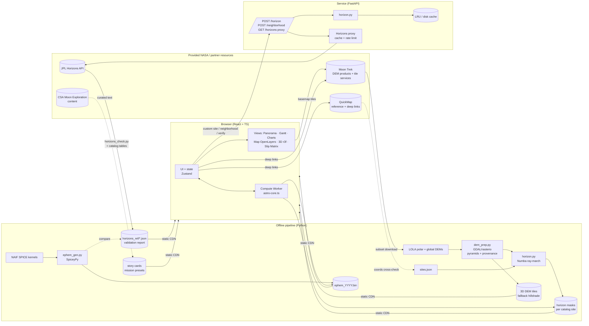

# Lunar Skyline — Design Document

> NASA Space Apps Challenge 2026 · *Lunar Landing Site Navigator*
>
> A web app that answers, in seconds, the two questions every lunar mission planner asks about a site/date:
> **"Will we have power?"** and **"Can we talk to Earth?"** — and shows *why*, using real terrain.

---

## 1. Problem framing

### 1.1 What the challenge actually asks for

| Challenge objective | How Lunar Skyline answers it |
|---|---|
| Interactive site selection & comparison | Curated site catalog + custom lat/lon + click-on-map; up to 4 pinned **Scenarios** side-by-side |
| Date & time flexibility | Landing date/time + mission duration, a timeline scrubber, and a **Slip Matrix** (sites × dates) |
| Sun & Earth position vs horizon | **Skyline Panorama**: 360° terrain silhouette with Sun and Earth discs and their tracks |
| Power & communication assessment | Solar elevation, visible disc fraction, panel power, % sunlit, longest night, Earth-visibility windows, **time to sunset / Earthset** countdowns |
| Multiple visualization approaches | Panorama, polar sky plot, Gantt timeline, elevation charts, polar map with heatmaps, 3D terrain with live shadows |
| Temporal dynamics | Animated playback over the mission window, a lunar day, or a lunar "season" |
| Accessibility across skill levels | **Planner mode** (dense numbers, exports) and **Explore mode** (guided story, plain language, Earth comparisons) |

### 1.2 Users

1. **Mission planner / engineer.** Needs fast, trustworthy numbers and quick re-evaluation when the date or site moves. Cares about worst cases such as the longest darkness or a comms gap at landing.
2. **Scientist.** Picks a site for its science value and needs to see what that site costs the engineering team.
3. **Educator / student / public.** Wants to understand why the south pole is so hard. Cares about intuition more than decimals.

### 1.3 Core insight we want users to *feel*

At the south pole the Sun never rises more than about **1.5°** above the mathematical horizon, because the Moon's spin axis is tilted only 1.54° to the ecliptic (Earth's is 23.4°). The Sun skims the horizon and circles the sky once per **29.5-day synodic month**. A ridge a few hundred metres high, kilometres away, can decide between continuous power and two weeks of darkness. Earth hangs low over the nearside horizon and rocks up and down by about ±6.7° (libration), so it rises and sets roughly every 27.2 days. **Location changes of a few hundred metres, or date changes of a few days, flip a site from great to unusable.** Every view in the app is built to make that obvious.

### 1.4 How we use the challenge's provided resources

The challenge names four resources: **JPL Horizons**, **QuickMap**, **Moon Trek** and the **CSA Moon Exploration portal**. The Background section says the first three are powerful but hard for non-specialists to use for rapid scenario comparison. So Lunar Skyline is **a fast, friendly layer on top of them, not a replacement**. We use each one for the job it is best at, we are transparent about it, and we make it one click to jump to the original tool for deeper analysis.

| Resource | Role in Lunar Skyline | Where in this doc |
|---|---|---|
| **JPL Horizons** | **Ephemeris authority.** (1) Ground truth that every computed Sun/Earth az/el is validated against, with a live "Verify with Horizons" button. (2) Source of record for catalog-site tables, and a per-site "Horizons cross-check" report. (3) Fixes our reference-frame conventions, because its lunar topocentric observer (`coord@301`) defines what az/el means | §2.1, §2.2, §6, §5.3 |
| **QuickMap** (ASU/LROC) | **Visual and terrain cross-reference.** (1) Deep link "Open this site in QuickMap" from every scenario. (2) Independent check of our horizon masks and illumination against its LOLA DEM and illumination layers. (3) Site coordinates and context for CLPS, Artemis and international landing sites | §3.2, §4, §6 |
| **Moon Trek** (NASA) | **Terrain source and basemap.** (1) Use its LOLA-derived polar DEM products and subset/download tool to get just the region we need. (2) Use its tile services as the polar map basemap, instead of building our own hillshade. (3) "Open in Moon Trek" deep link for 3D context | §2.4, §3.2, §5, §9 |
| **CSA Moon Exploration** | **Context and education content.** Canadian missions, technologies and Artemis contributions become mission-profile presets, Explore-mode story cards and a relay-comms use case (Gateway/Canadarm3) | §2.8, §3.3, §4, §7 |

**Principle: no number is unexplained or unverifiable.** Each scenario carries a small provenance footer listing the ephemeris source, DEM product, frame, time scale and a "Verify with Horizons / Open in QuickMap / Open in Moon Trek" row.

> **Caveat for the team.** The exact Horizons parameters, Moon Trek service endpoints and QuickMap URL parameters below come from memory of their public documentation. Confirm each against the live docs in the first hour (see the "Hour-0 verification checklist" in §8) before building on it.

---

## 2. Science & computation model

### 2.1 Reference frames and constants

| Item | Choice | Why |
|---|---|---|
| Body-fixed frame | `MOON_ME` (Mean-Earth / polar axis), realised from DE440 lunar orientation | LOLA topography (and therefore Moon Trek and QuickMap products) and published landing coordinates use ME. `MOON_PA` differs by about 800 m on the surface, so mixing the two is a classic bug. **Horizons calibration:** in hour 0 we query Horizons for a few polar and equatorial sites and confirm which frame its `coord@301` observer matches, by comparing against our `MOON_ME` and `MOON_PA` results. The winner is documented and locked in |
| Reference surface | Sphere, R = 1737.4 km | The LOLA reference radius. DEM heights are relative to it |
| Time scales | UI in UTC; computation in TDB (via SPICE) | Avoids silent offsets of about 69 s |
| Aberration correction | `LT+S` (light time + stellar aberration) | Apparent positions are what an antenna or array actually sees |
| Refraction | **None** | No atmosphere. The horizon is purely geometric (terrain + curvature) |

### 2.2 Ephemeris: precompute once, evaluate anywhere

**Key simplification.** We only need the Sun and Earth positions relative to the **Moon's centre**, expressed in `MOON_ME`. Any surface site can be derived from those analytically:

- **Sun.** The parallax across the Moon's radius is 1737 km / 1.5×10⁸ km ≈ 2.4″. The Sun direction from the Moon's centre is therefore exact enough for every site.
- **Earth.** The parallax is 1737 / 384 400 ≈ **0.26°**, which is about a quarter of Earth's apparent diameter (≈1.9°), so it can't be ignored. We compute `v_earth_topo = r_earth − r_site` exactly.
- **Libration.** Optical and physical libration are included automatically, because the `MOON_ME` orientation comes from the DE440 lunar libration solution.

**Offline generation (Python + SpiceyPy):**

```
kernels:  naif0012.tls                 (leap seconds)
          de440s.bsp                    (planetary ephemeris)
          moon_pa_de440_200625.bpc      (lunar orientation, high precision)
          moon_de440_220930.tf          (MOON_ME / MOON_PA frame definitions)
          pck00011.tpc                  (body radii)
          earth_latest_high_prec.bpc    (Earth orientation, for DSN visibility)

for t in 2026-01-01 … 2036-12-31 step 1 h:
    sun   = spkpos("SUN",   t, "MOON_ME", "LT+S", "MOON")
    earth = spkpos("EARTH", t, "MOON_ME", "LT+S", "MOON")
    dsn_el[k] = elevation of Moon at Goldstone / Madrid / Canberra   (stretch)
```

**Output:** `ephem_YYYY.bin`, one file per year. Each file is a header plus `Float32` records `[sun_xyz, earth_xyz, dsn_el×3]`. That's about 8 760 records × 36 B ≈ **315 KB per year**, roughly 3.5 MB for 11 years before gzip.

- **Interpolation:** cubic Hermite (or Catmull-Rom) between hourly samples. The Sun moves about 0.5°/h in lunar azimuth, so cubic interpolation keeps errors well under 1″.
- **Float32 precision:** about 0.02 km on Earth's 384 000 km distance, which is negligible.

This means **all ephemeris math runs in the browser**, with no network round trip, so scrubbing and animation are instant.

#### Horizons integration (three roles)

The Horizons API (`https://ssd.jpl.nasa.gov/api/horizons.api`) accepts a topocentric observer on the Moon, so it gives us exactly the numbers the challenge describes ("positions of the Sun and Earth as seen from any location on the Moon").

```
COMMAND      = '10' (Sun) | '399' (Earth)
CENTER       = 'coord@301'                      (body-fixed site on the Moon)
COORD_TYPE   = 'GEODETIC'
SITE_COORD   = 'lon_deg,lat_deg,alt_km'         (east longitude)
EPHEM_TYPE   = 'OBSERVER'
START_TIME / STOP_TIME / STEP_SIZE
QUANTITIES   = '4,10,13,20'   apparent az/el, illuminated fraction,
                              angular diameter, range & range-rate
APPARENT     = 'AIRLESS'      (no atmospheric refraction on the Moon)
ANG_FORMAT   = 'DEG',  CSV_FORMAT = 'YES'
```

1. **Validation oracle (MVP).** An automated script (`pipeline/horizons_check.py`) samples 20+ random site/time pairs, including polar, equatorial and far-side sites, and compares Horizons az/el and angular diameter with our browser-side results. The residual table and plot go into `docs/validation.md` and onto a slide. Target is < 0.01°.
2. **"Verify with Horizons" button (MVP-plus).** In the UI, any scenario can be re-queried live for the current playhead time. The result appears next to our value as `Δaz / Δel`. The browser calls our small backend `/api/horizons` proxy, which adds caching and rate limiting and avoids cross-origin issues. This button is the most direct way to show NASA judges that we trust Horizons as the authority.
3. **Source of record for catalog tables (optional).** For the roughly 30 catalog sites, we can batch-fetch Horizons Sun/Earth az/el at 1-hour steps for 2026–2028 and ship them as a **Horizons-sourced reference dataset** next to our computed one. The UI can then switch between "computed" and "Horizons table" and show that they agree. Custom sites always use our computed path, because a Horizons call per custom site is too slow for interactive use.

**Why we still precompute our own centre-based ephemeris.** Horizons is a per-request service (one site, one table). The slip matrix, neighborhood grid and custom sites need thousands of site/time evaluations, which only works with the centre-based approach above. The two approaches use the same JPL DE-series ephemerides, so they should agree closely. That agreement is the validation story.

**Fallback if the SPICE pipeline hits trouble.** If SpiceyPy or a kernel gives us frame problems at the hackathon, we can fall back to a Horizons-only pipeline for catalog sites (role 3) and still ship the MVP. This lowers schedule risk.

**Horizons practical notes.**
- Be polite: one request at a time, cache every response on disk keyed by the full query, and batch with `STEP_SIZE` rather than many single-time calls.
- Responses with large tables should be paged by date range.
- Pre-fetch everything the demo needs before the demo, so it does not depend on live network.

### 2.3 Topocentric geometry (runs in a Web Worker)

For a site at latitude φ, longitude λ, DEM height h and mast/array height m:

```
U = [cosφ cosλ, cosφ sinλ, sinφ]          (local up, spherical)
E = [−sinλ, cosλ, 0]                      (east)
N = U × E                                 (north)
r_site = (R + h + m) · U

v      = r_body − r_site
el     = asin( v·U / |v| )
az     = atan2( v·E, v·N )                (from north, clockwise)
ρ_sun  = asin(R_sun / |v_sun|)            (≈0.26–0.27°)
ρ_earth= asin(R_earth / |v_earth|)        (≈0.90–1.0°)
```

**Polar singularity.** Within about 0.01° of the pole, "north" is undefined. We then define N as **grid north** (toward 0° longitude in the polar stereographic map) and label the axis accordingly. Grid azimuth is also shown everywhere as an option, because it matches the map.

### 2.4 Horizon mask from LOLA topography

The horizon mask is **the** accuracy driver at the south pole.

**Data (Moon Trek first, PDS as backup):**
- **Primary: Moon Trek.** Moon Trek hosts the LOLA-derived south-polar DEM mosaics (e.g. the ~5 m, ~10 m, ~20 m polar products and the global LOLA DEM at ~118 m/px; confirm the exact names in the layer catalogue). We use Trek's **subset/download tool** to pull *only* the area we need (for example 80°S–pole and a margin for far-field mountains), instead of downloading multi-GB global files. Trek also gives us the **same DEM that QuickMap displays**, which makes cross-checking meaningful.
- **Backup: PDS Geosciences Node / NASA GSFC PGDA.** The original LOLA GeoTIFFs (same data, authoritative). Use these if Trek's subsetting is slow, or if we need raw 32-bit elevations rather than a rendered product.
- **Layer plan.** Polar DEM (finest) within ~10 km, mid-resolution polar DEM out to ~100 km, global DEM beyond that. Beyond 80°S the far field needs the lower-latitude global product, because horizon-setting mountains can lie outside the high-resolution tile.
- **Projection:** `+proj=stere +lat_0=-90 +lon_0=0 +k=1 +x_0=0 +y_0=0 +R=1737400 +units=m`. Verify that the Trek products use this projection and the same radius, then record it in each DEM's `provenance.json`.
- **Provenance.** `dem_prep.py` writes a `provenance.json` per product (source URL, product ID, resolution, date downloaded, checksum). The app shows it in the scenario footer.

**Algorithm** (Numba-accelerated Python, ~ms per site):

```
for az in 0° … 360° step 0.25°  (1440 rays):
    max_el = −90°
    for d in distances(10 m → 300 km, geometric spacing ~1–2 %):
        P_ll  = destination point on sphere from site along az at distance d
        level = DEM pyramid level appropriate for d     (fine near, coarse far)
        h_P   = bilinear(DEM[level], stereo(P_ll))
        P     = (R + h_P) · unit(P_ll)
        el    = asin( (P − r_site)·U / |P − r_site| )   (curvature handled exactly)
        max_el = max(max_el, el)
    mask[az] = max_el
```

- **Why 300 km?** A 6 km massif is visible from about √(2·R·h) ≈ 145 km away, plus the observer's own horizon distance. South-pole horizons are often set by mountains 50–150 km away (for example Malapert, the Leibnitz-β plateau, and Mons Mouton).
- **Multi-resolution:** use 5–20 m DEMs within about 10 km, 80–120 m within about 100 km, and 240 m beyond. This keeps a single mask to a few million samples.
- **Mask storage:** `Int16` centi-degrees × 1440 azimuths = **2.9 KB per site**.
- **Observer height matters.** A mast-height slider (0–20 m) recomputes the mask. Raising an array a few metres can add days of sunlight at the pole, which makes a great "aha" moment.

### 2.5 Derived quantities (per time step)

| Quantity | Definition |
|---|---|
| Solar elevation (geometric) | `el_sun` vs the mathematical horizon |
| Solar clearance | `el_sun − mask(az_sun)`, i.e. how far above the terrain the Sun is |
| Visible solar fraction `f_sun` | Fraction of the solar disc above the terrain line. Sample 9 vertical slices across the disc and use the mask's local slope |
| Earth clearance / `f_earth` | Same for Earth's disc. **Comm-visible** if clearance ≥ user margin (default 1°, for antenna beam and multipath) |
| Panel power | `P = S₀·(1 AU/r)²·f_sun·η·A·cos θ`, with S₀ = 1361 W/m² |
| Panel geometry options | Horizontal: `cos θ = sin el` (terrible at the pole). Vertical fixed at azimuth α: `cos el · max(0, cos(az−α))`. Vertical azimuth-tracking: `cos el`. Two-axis: `1` |
| Earth phase from site | Illuminated fraction of Earth (the opposite of the Moon's phase). Educational, and relevant to optical comms |
| Eclipse flag | Angle(Sun, Earth) < ρ_sun + ρ_earth, meaning Earth blocks the Sun (a lunar eclipse as seen from the Moon) |
| DSN visibility (stretch) | Moon elevation ≥ 10° at Goldstone, Madrid or Canberra. True DTE = Earth visible from the site **and** at least one complex sees the Moon |

### 2.6 Events and window metrics

**Event finding.** Sample the mission window every 10 min, then bisect each state change to 1 min. A 14-day window is about 2 000 samples, so this is effectively instant.

| Metric | Meaning |
|---|---|
| **Time to sunset** | Until `f_sun` falls below a threshold (default 50 %, configurable 0–100 %) |
| **Time to Earthset** | Until Earth clearance falls below the margin |
| Next sunrise / Earthrise | The same events in reverse |
| % sunlit, % Earth-visible, % **both** | Over the mission window |
| Longest continuous darkness | **Drives battery and heater sizing.** Usually a hard constraint |
| Longest comm gap | Drives autonomy requirements |
| Energy over window | ∫P dt (Wh) for the chosen panel configuration |
| Conditions at landing | Sun and Earth state at touchdown (landing usually needs comm, and sometimes specific lighting for terrain-relative navigation) |
| Number of day/night transitions | Thermal-cycling stress |

### 2.7 Fast "slip" analysis (sites × dates)

The naive approach recomputes every (site, landing date) window. Instead:

1. For each site, compute the state timeline once for the whole year at 30-min steps. That's 17 520 samples of `f_sun`, `earth_visible` and `P`.
2. Build **prefix sums** for the sunlit, Earth-visible and energy series, and a **run-length encoding** for darkness and comm gaps.
3. Any window `[t₀, t₀+D]` is then O(1) for the percentages and energy, and O(gaps) for the longest gap.

This gives 10 sites × 365 dates × any duration in well under a second in a Web Worker, so the Slip Matrix updates live as sliders move.

### 2.8 Viability scoring

Users pick a **mission profile** (preset or custom). A profile combines hard constraints with weights:

| Profile preset | Duration | Hard constraints | Soft weights |
|---|---|---|---|
| Small CLPS lander | 14 d | Earth visible at landing; longest dark ≤ 50 h | % both, energy |
| Rover (VIPER-like) | 100 d | Longest dark ≤ 100 h | % sunlit, % Earth-visible |
| Survive-the-night demo | 30 d | Earth visible at landing | Energy |
| Canadian lunar rover / utility vehicle (CSA-inspired) | ~14 d to months, set from the CSA portal | Earth visible at landing; user-set darkness limit | % sunlit, % Earth-visible, energy |
| Custom | any | user-defined | user-defined |

> The CSA preset exists to connect the tool to a Canadian-led mission class. Fill in real duration and constraints only from public CSA material on the Moon Exploration portal. Until then it is labelled "illustrative".

Each scenario gets a traffic light:
- **Red:** any hard constraint fails.
- **Amber:** within 10 % of a limit.
- **Green:** all constraints pass with margin.

There's also a 0–100 score from the weighted metrics. **Every score is explainable.** Clicking it shows exactly which constraint or metric drove it, because planners won't trust a black box.

---

## 3. Product design

### 3.1 Information architecture

```
┌────────────────────────────────────────────────────────────────────────────┐
│  Lunar Skyline     [Planner | Explore]     Profile: Small CLPS ▾   UTC ▾   │
├───────────────┬────────────────────────────────────────────────────────────┤
│ SCENARIOS     │  ┌─ Skyline Panorama ────────────────────────────────────┐ │
│ ● A Shackleton│  │ ▁▂▃▅▃▂▁   ☉→        ▂▃▂▁    🜨       ▁▂▅▆▅▃▂▁        │ │
│   rim, 3 Mar  │  │ N        E          S          W          N          │ │
│ ● B Nobile R1 │  └───────────────────────────────────────────────────────┘ │
│   , 3 Mar     │  ┌─ KPI cards ──────────────────────────────────────────┐  │
│ ○ C …         │  │ ☉ el 1.2° (+0.7° clr) │ Sunset in 4d 06h │ 87% lit   │  │
│ [+ Add]       │  │ 🜨 el 3.4° (+2.1° clr) │ Earthset 9d 11h  │ 54% comm  │  │
│               │  └──────────────────────────────────────────────────────┘  │
│ SITE PICKER   │  ┌─ Timeline (Gantt, synced across scenarios) ─────────┐   │
│ [catalog ▾]   │  │ A ☉ ██████████░░░██████   🜨 ████████░░░░░░░██████  │   │
│ lat/lon …     │  │ B ☉ ████░░░░░░░███████   🜨 ███████████████░░░░░  │   │
│ mast 2 m ─●── │  └──────────────────────────────────────────────────────┘  │
│               │  [▶ play]  ━━━━━━━●━━━━━━━━━━━━  T+3d 04h  ×1000            │
├───────────────┴────────────────────────────────────────────────────────────┤
│  Tabs:  Overview · Map · 3D · Slip Matrix · Neighborhood · Compare · Export │
└────────────────────────────────────────────────────────────────────────────┘
```

Global state: the **scenario set** plus a **shared playhead**. The playhead can run in absolute UTC or in **Mission Elapsed Time**, which aligns scenarios with different landing dates so they can be compared.

### 3.2 Views

1. **Skyline Panorama (hero view).**
   - A 360° azimuth × elevation strip showing the terrain silhouette (filled), the Sun and Earth discs, and their tracks over the window. Tracks are colour-coded by time, solid when visible and dashed when blocked.
   - Vertical exaggeration toggle (×1 / ×5 / ×20). The labelling is honest: real 1.5° Sun heights are almost invisible at ×1, which is itself the lesson.
   - Hovering the Sun shows "Sets behind ridge at az 137° in 4 d 06 h".
2. **Polar sky plot.** A classic fisheye with a terrain ring. It's familiar to astronomers, but at the pole everything bunches at the rim, which is why the panorama is the default.
3. **Timeline / Gantt.**
   - Lanes per scenario for Sun (lit / partial / dark), Earth (visible / blocked) and **Both**. Optional lanes for DSN and eclipse.
   - Sunset and Earthset countdown markers sit on the playhead.
   - Brushing a range zooms all views.
4. **Elevation chart.** Sun and Earth elevation over time, overlaid with `mask(az(t))`, the terrain height *in the body's current direction*. The gap between the two curves is the clearance, so you can see exactly when and why the Sun is lost.
5. **Polar Map.**
   - South-pole basemap in polar stereographic. Prefer **Moon Trek tile services** (WMTS) for the LOLA shaded-relief layer, which saves us generating and hosting hillshade tiles. If tiles are unavailable offline, fall back to a pre-rendered hillshade image of the area from our own DEM.
   - Site markers, Artemis candidate regions and permanently shadowed regions (PSR) outlines.
   - Click to set a custom site.
   - Sun and Earth direction arrows plus a terrain-shadow overlay for the current time (stretch).
   - **"Open in QuickMap" and "Open in Moon Trek" buttons** on the selected site, deep-linking to the same location so users can go deeper in the NASA tools. Link format is checked in the hour-0 checklist.
   - Optional **QuickMap illumination comparison:** a side-by-side image or screenshot of QuickMap's illumination for the same site/date next to our result, used in the validation doc rather than live.
6. **3D Terrain.**
   - A react-three-fiber mesh of a DEM tile of about 20 × 20 km around the site, with a directional light from the true Sun vector and shadow mapping. Earth appears as a textured sprite at its true position and phase.
   - Playback makes shadows sweep around the crater. A "lander eye" first-person camera shows the view from the deck.
   - This is the most compelling view for the public.
7. **Slip Matrix.**
   - A heatmap with rows = sites (or one site at different mast heights) and columns = landing dates (±90 days or a full year). Cell colour = viability score; red-hatched = hard-constraint fail.
   - Clicking a cell creates a scenario.
   - A **"Next 3 viable dates"** list directly answers "the launch slipped two weeks, now what?"
8. **Neighborhood Explorer.**
   - A heatmap of % sunlit (or score) over a 21 × 21 grid at 250 m spacing around a site, for the current window.
   - Shows that moving 500 m changes the answer. Computed by the backend horizon service and cached.
9. **Compare.**
   - Columns of KPI cards with **deltas vs a baseline** (e.g. "+3.2 d sunlight, −1 comm window, longest night −41 h").
   - Includes a synchronized mini-panorama for each scenario.

### 3.3 Explore mode (education)

A 6-step guided story built on the same views with simpler copy:

1. **Tilt.** Side-by-side Earth (23.4°) and Moon (1.54°) axes, and what that means for the Sun's path.
2. **Skimming Sun.** Animate one lunar day at the pole in the panorama, showing the Sun circling the horizon.
3. **Long shadows.** The Sun at 1.5° makes a 1 m rock cast a **38 m** shadow. An interactive slider shows rock height vs shadow length.
4. **Peaks of light and craters of eternal night.** Map overlay of high-illumination ridges vs PSRs.
5. **Earth wobbles.** Libration makes Earth bob up and down above the nearside horizon, which means comm windows.
6. **Your turn.** "Pick a landing site for a 14-day mission"; the score gives feedback.

"Compare with Earth" toggle: show the same panorama for a familiar Earth city at the same date.

**Canadian story cards (from the CSA Moon Exploration portal).** Optional cards inside the story, each linking to the portal:
- *Staying in touch:* why a relay at the Moon matters when Earth is below the horizon, and how Canadarm3 on Gateway fits into Artemis. Ties into the relay option in §7.
- *Canadian missions and instruments:* show Canadian-supported payloads or rovers in the catalog (§4) and run them through the same sun and Earth analysis.
- *Canadians in Artemis:* a short human-interest link to give the public a personal hook.

Content must be written from the portal's current pages, not from memory, so it is accurate at submission time.

### 3.4 UX principles

- **Answer first.** The KPI cards and traffic light come before any plot.
- **Countdowns are first-class.** "Sunset in 4 d 06 h" is large, colour-coded and always visible.
- **Every number has a "why".** Hovering a metric highlights the part of the panorama or timeline that produced it.
- **Fast by construction.** All interactive recomputation is client-side, in a worker, and under 100 ms.
- **Accessibility.**
  - Colour-blind-safe palette (Sun = amber, Earth = blue; also distinguished by shape and pattern).
  - Keyboard navigation for the timeline.
  - ARIA live text summaries such as "Sun visible 87 % of mission; longest darkness 31 h starting 7 Mar 14:00 UTC".
  - Glossary tooltips and a units toggle.
- **Shareable state.** The full scenario set is encoded in the URL, so `?s=…` reproduces exactly what a colleague saw.
- **Export.** CSV / JSON of time series and events, PNG of any view, and a one-page PDF "site brief".

---

## 4. Site catalog

`sites.json` holds name, lat, lon, category, agency, status, notes and source URL. **Verify every coordinate against the official source before the demo.** The values below are approximate and for planning only.

| Category | Sites (approximate, MOON_ME, °) |
|---|---|
| Apollo | 11 (0.674 N, 23.473 E) · 12 (3.012 S, 23.422 W) · 14 (3.645 S, 17.471 W) · 15 (26.132 N, 3.634 E) · 16 (8.973 S, 15.500 E) · 17 (20.191 N, 30.772 E) |
| International | Chang'e 4 (45.44 S, 177.60 E) · Chang'e 6 (41.64 S, 153.99 W) · Chandrayaan-3 "Shiv Shakti" (69.37 S, 32.32 E) · SLIM (13.32 S, 25.25 E) |
| Commercial / CLPS | IM-1 Odysseus, near Malapert A (~80.1 S, 1.4 E) · IM-2 Athena, Mons Mouton (~84.8 S, 29 E) · Blue Ghost M1, Mare Crisium (~18.6 N, 61.8 E) |
| Artemis III candidate regions (NASA, 2024 list) | Peak near Cabeus B · Haworth · Malapert Massif · Mons Mouton Plateau · Mons Mouton · Nobile Rim 1 · Nobile Rim 2 · de Gerlache Rim 2 · Slater Plain. Use a representative point per region and draw the region polygon |
| Notable polar points | Shackleton rim / Shackleton–de Gerlache connecting ridge (high-illumination) · Shackleton floor (PSR, a good counter-example) · former VIPER target near Nobile |
| Upcoming | Chang'e 7 target region (near Shackleton) · other announced CLPS and international targets as of the hackathon |
| Canadian / CSA | Any landing site that carries a Canadian-supported payload or rover, as listed on the CSA Moon Exploration portal. Tagged `agency: CSA` and shown with a maple-leaf badge. Gateway/Canadarm3 is not a surface site, but appears in the relay stretch feature |

**Where coordinates come from.** The primary source is each site's official mission page. The secondary check is **QuickMap and Moon Trek**, which show landing sites and Artemis regions. We compare our `sites.json` against what they display and record any disagreement in the `notes` field. Cross-checking against these two tools is also the quickest way to catch ME/PA frame errors (an offset of about 800 m).

Equatorial Apollo sites are deliberately included as **contrast cases**: a classic ~14-day day and ~14-day night with the Sun high overhead. They make the polar extremes obvious.

---

## 5. System architecture



### 5.1 Why this split

- **Static-first.** The catalog sites run with zero backend. If the service is down at demo time, the app still works.
- **Backend only for heavy terrain work and Horizons access.** That means custom sites, the neighborhood grid and the Horizons "verify" proxy. The full-resolution polar DEMs are hundreds of MB to GB, which is too big for a browser.
- **External services are enhancements, not dependencies.** Moon Trek tiles, live Horizons verification and QuickMap links are all optional at runtime. If any is unreachable, the app falls back to bundled data (fallback hillshade image, pre-fetched Horizons reference tables) and shows a small notice.
- **Graceful fallback.** If the horizon service is unreachable, custom sites use the **spherical horizon** (a flat 0° mask corrected for observer height) with a visible "⚠ terrain not included" badge.
- **One source of truth for math.** The Python reference implementation generates **golden test fixtures**, and the TypeScript `astro-core` must match them in CI to within 0.01°.

### 5.2 Tech stack

| Layer | Choice |
|---|---|
| Offline / backend | Python 3.12, SpiceyPy, NumPy, Numba, rasterio/GDAL, pyproj, FastAPI, uvicorn |
| Frontend | React + TypeScript + Vite, Zustand, Comlink (worker RPC) |
| Charts | D3 (panorama, Gantt, heatmaps; custom SVG/Canvas) |
| Map | OpenLayers + proj4 (native polar stereographic support) |
| 3D | three.js via react-three-fiber + drei |
| Tests | pytest (pipeline), Vitest (astro-core), Playwright (smoke) |
| Deploy | Frontend on GitHub Pages / Vercel; backend on Fly.io / Render (single small container) |

### 5.3 API

```
GET  /api/health
POST /api/horizon        { lat, lon, mast_m=2, az_step=0.25 }
     → { az_step, mask_cdeg: Int16[1440] (base64), dem_source, height_m }
POST /api/neighborhood   { lat, lon, radius_km=2.5, step_m=250, mast_m, start, end, profile }
     → { grid: [{lat, lon, pct_sun, pct_earth, longest_dark_h, score}], ... }
GET  /api/horizons       ?lat&lon&alt_km&body=sun|earth&start&stop&step
     → { rows: [{t_utc, az, el, ang_diam, illum_frac}], source: "JPL Horizons", query_url }
     (cached on disk by full query; one upstream request at a time; returns the
      exact upstream URL so users can reproduce it)
GET  /api/links          ?lat&lon&date
     → { quickmap_url, moontrek_url, horizons_url }   (deep links for the UI)
```

Responses are cached by a rounded-coordinate key. Neighborhood jobs larger than a few seconds stream progress over SSE.

### 5.4 Repository layout

```
southpole/
├── DESIGN.md
├── pipeline/            # offline Python
│   ├── ephem_gen.py
│   ├── dem_prep.py      # Moon Trek / PDS DEM → pyramids + provenance.json
│   ├── horizon.py
│   ├── horizons_check.py  # validation vs JPL Horizons; also fetches catalog reference tables
│   ├── fixtures_gen.py  # golden test data for astro-core
│   └── kernels/         # (gitignored) SPICE kernels
├── server/              # FastAPI service: horizon masks, neighborhood, Horizons proxy, deep links
│   ├── app.py
│   └── horizons_proxy.py
├── content/
│   └── csa/             # curated CSA story cards and mission presets (with source links)
├── web/
│   ├── public/data/     # ephem_*.bin, masks/*.bin, horizons_ref/*.json, sites.json, tiles/
│   └── src/
│       ├── core/        # astro-core.ts, events.ts, metrics.ts, slip.ts (pure, tested)
│       ├── worker/
│       ├── state/
│       ├── views/       # Panorama, SkyPlot, Gantt, ElevationChart, PolarMap, Terrain3D, SlipMatrix, Neighborhood, Compare
│       └── explore/     # guided story
└── docs/validation.md
```

---

## 6. Validation plan (credibility matters to judges)

| Check | Method | Target |
|---|---|---|
| Ephemeris (Horizons) | astro-core vs JPL Horizons topocentric (`coord@301`, `APPARENT='AIRLESS'`) az/el **and angular diameter** at 20+ random site/times, covering polar, equatorial and far-side sites and a leap-second boundary | < 0.01° |
| Frame calibration (Horizons) | A known landing site (e.g. Apollo 11) in `MOON_ME` vs `MOON_PA` against Horizons output | One frame matches; the other is off by about 800 m-equivalent |
| Earth parallax / libration | Earth az/el range at the pole over 1 year, cross-checked against Horizons Earth az/el at the same site | Same range; qualitative match to ±6.7° latitude / ±7.9° longitude libration |
| Horizon masks (QuickMap / Moon Trek) | For 3 polar sites, compare our terrain silhouette and Sun-blocked intervals against QuickMap's LOLA DEM and illumination layers, and against Moon Trek's elevation profile and 3D view of the same DEM. Use screenshots in `docs/validation.md` | Silhouette shape matches; < 0.2° typical |
| Site coordinates (QuickMap / Moon Trek) | Plot every `sites.json` entry in both tools and confirm it lands on the intended feature | All within DEM pixel size, or noted |
| Terrain data consistency | Sample elevation at 20 points in our DEM vs Moon Trek's elevation readout for the same product | Exact or within quantisation |
| Illumination | Average % illumination at known high-illumination points vs published LOLA-based illumination maps (e.g. Mazarico et al. 2011, Gläser et al.) | Same ranking; within ~5–10 % |
| Equatorial sanity | Apollo 11 sunrise/sunset times vs Horizons; daylight ≈ 14.77 d | < 5 min |
| Regression | Golden fixtures (Python ↔ TS) in CI | Exact within tolerance |

A `docs/validation.md` page with these plots doubles as a strong slide for the presentation.

**Documented limitations** (said openly in the app's "About & accuracy" panel):
- DEM resolution limits near-field accuracy, and local boulders and lander self-shadowing aren't modelled.
- The surface is spherical, so there's no slope or tilt of the lander deck in the MVP. Local slope is a stretch goal.
- There's no thermal model.
- Comm uses Earth line-of-sight plus optional DSN elevation. There's no link budget.

---

## 7. Stretch features (in priority order)

1. **Local slope and lander tilt** from the DEM, affecting panel incidence and antenna pointing.
2. **Precomputed horizon tiles** for all of 80–90°S at about 1 km spacing, served as lazy-loaded tiles. This makes the whole south pole fully static and offline-capable.
3. **Illumination / Earth-visibility heatmap** for the whole polar map over a chosen window.
4. **Simple thermal indicator**: hours since last sunlight, compared with survival limits.
5. **Relay option**: toggle a notional relay orbiter (e.g. Lunar Gateway NRHO visibility) to show the comm improvement. Horizons can supply spacecraft or NRHO ephemerides where they are published, and the CSA portal gives the Gateway/Canadarm3 context. This is the most natural bridge between the comms analysis and the CSA resource.
6. **Collaboration**: shareable scenario links already exist; add commenting and a "decision log" export for science/engineering trade meetings.

---

## 8. 48-hour hackathon plan

**Team roles (adapt to team size):**
- **Astro / data:** ephemeris pipeline, astro-core, validation.
- **Terrain:** DEM prep, horizon engine, FastAPI service, neighborhood grid.
- **Frontend viz:** panorama, Gantt, charts, slip matrix, map.
- **3D + UX / story:** 3D terrain, Explore mode, design system, demo video, slides.

**Before the event** (if the rules allow): download the SPICE kernels; use Moon Trek's subset tool to download the polar and global DEM products; test one Horizons query end to end; agree on the stack; scaffold empty repos.

**Hour-0 verification checklist** (about 45 minutes, split across the team; nothing below should be assumed):
- [ ] **Horizons:** one working `coord@301` request for the Sun and Earth. Confirm parameter names, longitude convention (east positive), output columns, and how it treats the lunar frame (ME vs PA, via the calibration test in §2.1). Check request size and rate limits.
- [ ] **Horizons from the browser:** does the API allow direct cross-origin calls? If not, the backend proxy is mandatory, not optional.
- [ ] **Moon Trek:** identify the exact south-polar DEM layer names and resolutions; confirm the subset/download workflow, output format (GeoTIFF), projection and units; find the tile service URL for the shaded-relief layer and confirm it works in OpenLayers with the polar projection.
- [ ] **QuickMap:** confirm the deep-link URL parameters (location, zoom, layers, date) and note which illumination and DEM layers to use for the cross-checks.
- [ ] **CSA portal:** list the current Canadian missions, payloads and Artemis items; pick 3–5 for story cards and note the source URLs.
- [ ] **Terms of use:** confirm acceptable use and attribution for each service, and add the credits to the About panel.

| Hours | Milestone | Done when |
|---|---|---|
| 0–4 | Hour-0 checklist; kernels → `ephem_2026-2028.bin`; **first Horizons comparison table**; DEM subset from Moon Trek loaded; `sites.json` drafted; React shell with site picker and date picker | Sun/Earth az/el for one site printed in the browser **and within 0.01° of Horizons** |
| 4–12 | **Horizon masks for catalog sites**; astro-core events and metrics; **Skyline Panorama** v1 | Panorama shows terrain + Sun + Earth tracks for Shackleton rim |
| 12–20 | KPI cards + countdowns; Gantt timeline; playback; scenario pinning + Compare | **MVP demoable end-to-end** |
| 20–28 | Slip Matrix + "next viable dates"; FastAPI custom-site horizon; polar map with Moon Trek basemap; **"Verify with Horizons" button; QuickMap / Moon Trek deep links** | Slip-a-launch story works; verify button returns a Δ |
| 28–36 | 3D terrain with live shadows; Neighborhood Explorer; **full validation run (Horizons table, QuickMap / Moon Trek screenshots)** | "Move 500 m" and shadow-sweep stories work; `docs/validation.md` drafted |
| 36–42 | Explore mode story **including CSA story cards**; accessibility pass; URL state; export; provenance footers and credits | Non-expert can complete the guided story |
| 42–48 | Bug bash, deploy, **demo video**, slides, project page | Submitted |

**Cut line if behind:** drop 3D and Neighborhood first. The panorama, timeline, KPI cards, compare and slip matrix make the complete core story. **Do not cut** the Horizons validation, the provenance footer or the deep links. They are cheap and they show we used the provided resources properly.

### 8.1 Demo script (~2 min, adapt to submission format)

1. "Your lander is scheduled for Shackleton rim on 3 March." The panorama shows 87 % sunlit and Earth visible at landing: green.
2. "Launch slips 11 days." Drag the date. The score goes red: a 60 h night exceeds the battery limit.
3. Open the Slip Matrix. It suggests Nobile Rim 1 on the same date, or Shackleton on 28 March. Pin both and compare deltas.
4. Open the Neighborhood view: moving 400 m onto the ridge crest restores power.
5. Switch to 3D and play a lunar day. Shadows sweep, and Earth bobs above the horizon.
6. Click **Verify with Horizons**: "Our Sun elevation 1.204°, Horizons 1.204°, Δ 0.000°". Then **Open in QuickMap** to show the same ridge in NASA's own tool.
7. "And for a classroom…" Explore mode shows the 38 m shadow of a 1 m rock, then a Canadian story card on why relays and Canadarm3 matter when Earth drops below the horizon.

---

## 9. Risks & mitigations

| Risk | Mitigation |
|---|---|
| DEM files huge or slow to process | Use Moon Trek's subset tool to download only the region of interest; crop early; build pyramids once; use coarse DEMs for far field |
| Moon Trek or QuickMap down / slow / changes URLs | Both are optional at runtime. Bundle a fallback hillshade image, pre-download DEMs, and keep deep links in one config file so they can be updated quickly |
| Horizons rate limits, cross-origin blocks or downtime | Backend proxy with disk cache; pre-fetch the demo's reference tables; "Verify" degrades to showing the cached Horizons table |
| Horizons lunar frame differs from our assumption | Hour-0 calibration test (§2.1); fall back to whichever frame matches, and document it |
| CSA content out of date or inaccurate | Write story cards only from the live portal at submission time, link to sources, and label unverified items "illustrative" |
| Frame mismatch (ME vs PA) moves sites by about 800 m | Single frame (`MOON_ME`) everywhere; a unit test compares a known landing site against published coordinates |
| Polar azimuth singularity | Grid-north fallback near the pole; display grid azimuth by default for polar sites |
| UTC/TDB confusion | Only SPICE converts time scales; the UI is UTC; fixtures include a leap-second boundary test |
| Browser performance in 3D | Limit mesh to about 512²; use LOD; switch shadow-map resolution by device |
| Scope creep | MVP cut line defined above; features are flagged on or off |
| Backend down during judging | Static-first design; catalog sites need no server |

---

## 10. Data & reference sources

- NAIF SPICE generic kernels: <https://naif.jpl.nasa.gov/pub/naif/generic_kernels/>
- SpiceyPy: <https://github.com/AndrewAnnex/SpiceyPy>
**Provided by the challenge:**
- JPL Horizons System (API docs): <https://ssd-api.jpl.nasa.gov/doc/horizons.html>
- LROC QuickMap (ASU): <https://quickmap.lroc.asu.edu/>
- NASA Moon Trek: <https://trek.nasa.gov/moon/>
- CSA Moon Exploration portal: find the current link from the challenge Resources tab

**Supporting sources:**
- NAIF SPICE generic kernels: <https://naif.jpl.nasa.gov/pub/naif/generic_kernels/>
- SpiceyPy: <https://github.com/AndrewAnnex/SpiceyPy>
- LOLA data (PDS Geosciences Node): <https://pds-geosciences.wustl.edu/missions/lro/lola.htm> (backup for DEMs)
- NASA GSFC Planetary Geodesy Data Archive (high-res polar DEMs, illumination products): <https://pgda.gsfc.nasa.gov/>
- Mazarico, E. et al. (2011), *Illumination conditions of the lunar polar regions using LOLA topography*, Icarus 211.

**Credits to show in the app's About panel:** NASA JPL (Horizons, SPICE), NASA/GSFC/ASU (LOLA, LROC, QuickMap, Moon Trek), and the Canadian Space Agency (content links). Add the exact attribution wording each service requires.
