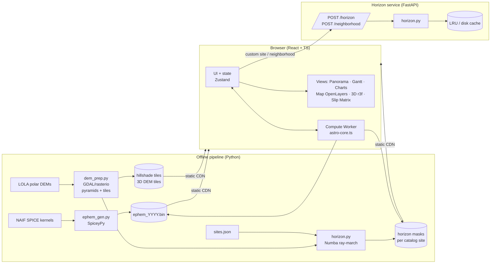

# Lunar Skyline — Design Document

> NASA Space Apps Challenge 2026 · *Lunar Landing Site Navigator*
>
> A web app that answers, in seconds, the two questions every lunar mission planner asks about a site/date:
> **"Will we have power?"** and **"Can we talk to Earth?"** — and shows *why*, using real terrain.

---

## 1. Problem framing

### 1.1 What the challenge actually asks for

| Challenge objective | How Lunar Skyline answers it |
|---|---|
| Interactive site selection & comparison | Curated site catalog + custom lat/lon + click-on-map; up to 4 pinned **Scenarios** side-by-side |
| Date & time flexibility | Landing date/time + mission duration, a timeline scrubber, and a **Slip Matrix** (sites × dates) |
| Sun & Earth position vs horizon | **Skyline Panorama**: 360° terrain silhouette with Sun and Earth discs and their tracks |
| Power & communication assessment | Solar elevation, visible disc fraction, panel power, % sunlit, longest night, Earth-visibility windows, **time to sunset / Earthset** countdowns |
| Multiple visualization approaches | Panorama, polar sky plot, Gantt timeline, elevation charts, polar map with heatmaps, 3D terrain with live shadows |
| Temporal dynamics | Animated playback over the mission window, a lunar day, or a lunar "season" |
| Accessibility across skill levels | **Planner mode** (dense numbers, exports) and **Explore mode** (guided story, plain language, Earth comparisons) |

### 1.2 Users

1. **Mission planner / engineer.** Needs fast, trustworthy numbers and quick re-evaluation when the date or site moves. Cares about worst cases such as the longest darkness or a comms gap at landing.
2. **Scientist.** Picks a site for its science value and needs to see what that site costs the engineering team.
3. **Educator / student / public.** Wants to understand why the south pole is so hard. Cares about intuition more than decimals.

### 1.3 Core insight we want users to *feel*

At the south pole the Sun never rises more than about **1.5°** above the mathematical horizon, because the Moon's spin axis is tilted only 1.54° to the ecliptic (Earth's is 23.4°). The Sun skims the horizon and circles the sky once per **29.5-day synodic month**. A ridge a few hundred metres high, kilometres away, can decide between continuous power and two weeks of darkness. Earth hangs low over the nearside horizon and rocks up and down by about ±6.7° (libration), so it rises and sets roughly every 27.2 days. **Location changes of a few hundred metres, or date changes of a few days, flip a site from great to unusable.** Every view in the app is built to make that obvious.

---

## 2. Science & computation model

### 2.1 Reference frames and constants

| Item | Choice | Why |
|---|---|---|
| Body-fixed frame | `MOON_ME` (Mean-Earth / polar axis), realised from DE440 lunar orientation | LOLA topography and published landing coordinates use ME. `MOON_PA` differs by about 800 m on the surface, so mixing the two is a classic bug |
| Reference surface | Sphere, R = 1737.4 km | The LOLA reference radius. DEM heights are relative to it |
| Time scales | UI in UTC; computation in TDB (via SPICE) | Avoids silent offsets of about 69 s |
| Aberration correction | `LT+S` (light time + stellar aberration) | Apparent positions are what an antenna or array actually sees |
| Refraction | **None** | No atmosphere. The horizon is purely geometric (terrain + curvature) |

### 2.2 Ephemeris: precompute once, evaluate anywhere

**Key simplification.** We only need the Sun and Earth positions relative to the **Moon's centre**, expressed in `MOON_ME`. Any surface site can be derived from those analytically:

- **Sun.** The parallax across the Moon's radius is 1737 km / 1.5×10⁸ km ≈ 2.4″. The Sun direction from the Moon's centre is therefore exact enough for every site.
- **Earth.** The parallax is 1737 / 384 400 ≈ **0.26°**, which is about a quarter of Earth's apparent diameter (≈1.9°), so it can't be ignored. We compute `v_earth_topo = r_earth − r_site` exactly.
- **Libration.** Optical and physical libration are included automatically, because the `MOON_ME` orientation comes from the DE440 lunar libration solution.

**Offline generation (Python + SpiceyPy):**

```
kernels:  naif0012.tls                 (leap seconds)
          de440s.bsp                    (planetary ephemeris)
          moon_pa_de440_200625.bpc      (lunar orientation, high precision)
          moon_de440_220930.tf          (MOON_ME / MOON_PA frame definitions)
          pck00011.tpc                  (body radii)
          earth_latest_high_prec.bpc    (Earth orientation, for DSN visibility)

for t in 2026-01-01 … 2036-12-31 step 1 h:
    sun   = spkpos("SUN",   t, "MOON_ME", "LT+S", "MOON")
    earth = spkpos("EARTH", t, "MOON_ME", "LT+S", "MOON")
    dsn_el[k] = elevation of Moon at Goldstone / Madrid / Canberra   (stretch)
```

**Output:** `ephem_YYYY.bin`, one file per year. Each file is a header plus `Float32` records `[sun_xyz, earth_xyz, dsn_el×3]`. That's about 8 760 records × 36 B ≈ **315 KB per year**, roughly 3.5 MB for 11 years before gzip.

- **Interpolation:** cubic Hermite (or Catmull-Rom) between hourly samples. The Sun moves about 0.5°/h in lunar azimuth, so cubic interpolation keeps errors well under 1″.
- **Float32 precision:** about 0.02 km on Earth's 384 000 km distance, which is negligible.

This means **all ephemeris math runs in the browser**, with no network round trip, so scrubbing and animation are instant.

**Fallback / validation path:** the JPL Horizons API supports topocentric lunar observers (`CENTER='coord@301'`), so we can spot-check any site/time.

### 2.3 Topocentric geometry (runs in a Web Worker)

For a site at latitude φ, longitude λ, DEM height h and mast/array height m:

```
U = [cosφ cosλ, cosφ sinλ, sinφ]          (local up, spherical)
E = [−sinλ, cosλ, 0]                      (east)
N = U × E                                 (north)
r_site = (R + h + m) · U

v      = r_body − r_site
el     = asin( v·U / |v| )
az     = atan2( v·E, v·N )                (from north, clockwise)
ρ_sun  = asin(R_sun / |v_sun|)            (≈0.26–0.27°)
ρ_earth= asin(R_earth / |v_earth|)        (≈0.90–1.0°)
```

**Polar singularity.** Within about 0.01° of the pole, "north" is undefined. We then define N as **grid north** (toward 0° longitude in the polar stereographic map) and label the axis accordingly. Grid azimuth is also shown everywhere as an option, because it matches the map.

### 2.4 Horizon mask from LOLA topography

The horizon mask is **the** accuracy driver at the south pole.

**Data:**
- LOLA polar stereographic DEMs from the PDS Geosciences Node and NASA GSFC PGDA. Examples: ~5 m/px for poleward of ~87.5°S, ~20 m/px for poleward of ~85°S, and coarser (~80–240 m/px) products out to 75–80°S. Check the challenge Resources tab for the specific products provided.
- Projection: `+proj=stere +lat_0=-90 +lon_0=0 +k=1 +x_0=0 +y_0=0 +R=1737400 +units=m`.

**Algorithm** (Numba-accelerated Python, ~ms per site):

```
for az in 0° … 360° step 0.25°  (1440 rays):
    max_el = −90°
    for d in distances(10 m → 300 km, geometric spacing ~1–2 %):
        P_ll  = destination point on sphere from site along az at distance d
        level = DEM pyramid level appropriate for d     (fine near, coarse far)
        h_P   = bilinear(DEM[level], stereo(P_ll))
        P     = (R + h_P) · unit(P_ll)
        el    = asin( (P − r_site)·U / |P − r_site| )   (curvature handled exactly)
        max_el = max(max_el, el)
    mask[az] = max_el
```

- **Why 300 km?** A 6 km massif is visible from about √(2·R·h) ≈ 145 km away, plus the observer's own horizon distance. South-pole horizons are often set by mountains 50–150 km away (for example Malapert, the Leibnitz-β plateau, and Mons Mouton).
- **Multi-resolution:** use 5–20 m DEMs within about 10 km, 80–120 m within about 100 km, and 240 m beyond. This keeps a single mask to a few million samples.
- **Mask storage:** `Int16` centi-degrees × 1440 azimuths = **2.9 KB per site**.
- **Observer height matters.** A mast-height slider (0–20 m) recomputes the mask. Raising an array a few metres can add days of sunlight at the pole, which makes a great "aha" moment.

### 2.5 Derived quantities (per time step)

| Quantity | Definition |
|---|---|
| Solar elevation (geometric) | `el_sun` vs the mathematical horizon |
| Solar clearance | `el_sun − mask(az_sun)`, i.e. how far above the terrain the Sun is |
| Visible solar fraction `f_sun` | Fraction of the solar disc above the terrain line. Sample 9 vertical slices across the disc and use the mask's local slope |
| Earth clearance / `f_earth` | Same for Earth's disc. **Comm-visible** if clearance ≥ user margin (default 1°, for antenna beam and multipath) |
| Panel power | `P = S₀·(1 AU/r)²·f_sun·η·A·cos θ`, with S₀ = 1361 W/m² |
| Panel geometry options | Horizontal: `cos θ = sin el` (terrible at the pole). Vertical fixed at azimuth α: `cos el · max(0, cos(az−α))`. Vertical azimuth-tracking: `cos el`. Two-axis: `1` |
| Earth phase from site | Illuminated fraction of Earth (the opposite of the Moon's phase). Educational, and relevant to optical comms |
| Eclipse flag | Angle(Sun, Earth) < ρ_sun + ρ_earth, meaning Earth blocks the Sun (a lunar eclipse as seen from the Moon) |
| DSN visibility (stretch) | Moon elevation ≥ 10° at Goldstone, Madrid or Canberra. True DTE = Earth visible from the site **and** at least one complex sees the Moon |

### 2.6 Events and window metrics

**Event finding.** Sample the mission window every 10 min, then bisect each state change to 1 min. A 14-day window is about 2 000 samples, so this is effectively instant.

| Metric | Meaning |
|---|---|
| **Time to sunset** | Until `f_sun` falls below a threshold (default 50 %, configurable 0–100 %) |
| **Time to Earthset** | Until Earth clearance falls below the margin |
| Next sunrise / Earthrise | The same events in reverse |
| % sunlit, % Earth-visible, % **both** | Over the mission window |
| Longest continuous darkness | **Drives battery and heater sizing.** Usually a hard constraint |
| Longest comm gap | Drives autonomy requirements |
| Energy over window | ∫P dt (Wh) for the chosen panel configuration |
| Conditions at landing | Sun and Earth state at touchdown (landing usually needs comm, and sometimes specific lighting for terrain-relative navigation) |
| Number of day/night transitions | Thermal-cycling stress |

### 2.7 Fast "slip" analysis (sites × dates)

The naive approach recomputes every (site, landing date) window. Instead:

1. For each site, compute the state timeline once for the whole year at 30-min steps. That's 17 520 samples of `f_sun`, `earth_visible` and `P`.
2. Build **prefix sums** for the sunlit, Earth-visible and energy series, and a **run-length encoding** for darkness and comm gaps.
3. Any window `[t₀, t₀+D]` is then O(1) for the percentages and energy, and O(gaps) for the longest gap.

This gives 10 sites × 365 dates × any duration in well under a second in a Web Worker, so the Slip Matrix updates live as sliders move.

### 2.8 Viability scoring

Users pick a **mission profile** (preset or custom). A profile combines hard constraints with weights:

| Profile preset | Duration | Hard constraints | Soft weights |
|---|---|---|---|
| Small CLPS lander | 14 d | Earth visible at landing; longest dark ≤ 50 h | % both, energy |
| Rover (VIPER-like) | 100 d | Longest dark ≤ 100 h | % sunlit, % Earth-visible |
| Survive-the-night demo | 30 d | Earth visible at landing | Energy |
| Custom | any | user-defined | user-defined |

Each scenario gets a traffic light:
- **Red:** any hard constraint fails.
- **Amber:** within 10 % of a limit.
- **Green:** all constraints pass with margin.

There's also a 0–100 score from the weighted metrics. **Every score is explainable.** Clicking it shows exactly which constraint or metric drove it, because planners won't trust a black box.

---

## 3. Product design

### 3.1 Information architecture

```
┌────────────────────────────────────────────────────────────────────────────┐
│  Lunar Skyline     [Planner | Explore]     Profile: Small CLPS ▾   UTC ▾   │
├───────────────┬────────────────────────────────────────────────────────────┤
│ SCENARIOS     │  ┌─ Skyline Panorama ────────────────────────────────────┐ │
│ ● A Shackleton│  │ ▁▂▃▅▃▂▁   ☉→        ▂▃▂▁    🜨       ▁▂▅▆▅▃▂▁        │ │
│   rim, 3 Mar  │  │ N        E          S          W          N          │ │
│ ● B Nobile R1 │  └───────────────────────────────────────────────────────┘ │
│   , 3 Mar     │  ┌─ KPI cards ──────────────────────────────────────────┐  │
│ ○ C …         │  │ ☉ el 1.2° (+0.7° clr) │ Sunset in 4d 06h │ 87% lit   │  │
│ [+ Add]       │  │ 🜨 el 3.4° (+2.1° clr) │ Earthset 9d 11h  │ 54% comm  │  │
│               │  └──────────────────────────────────────────────────────┘  │
│ SITE PICKER   │  ┌─ Timeline (Gantt, synced across scenarios) ─────────┐   │
│ [catalog ▾]   │  │ A ☉ ██████████░░░██████   🜨 ████████░░░░░░░██████  │   │
│ lat/lon …     │  │ B ☉ ████░░░░░░░███████   🜨 ███████████████░░░░░  │   │
│ mast 2 m ─●── │  └──────────────────────────────────────────────────────┘  │
│               │  [▶ play]  ━━━━━━━●━━━━━━━━━━━━  T+3d 04h  ×1000            │
├───────────────┴────────────────────────────────────────────────────────────┤
│  Tabs:  Overview · Map · 3D · Slip Matrix · Neighborhood · Compare · Export │
└────────────────────────────────────────────────────────────────────────────┘
```

Global state: the **scenario set** plus a **shared playhead**. The playhead can run in absolute UTC or in **Mission Elapsed Time**, which aligns scenarios with different landing dates so they can be compared.

### 3.2 Views

1. **Skyline Panorama (hero view).**
   - A 360° azimuth × elevation strip showing the terrain silhouette (filled), the Sun and Earth discs, and their tracks over the window. Tracks are colour-coded by time, solid when visible and dashed when blocked.
   - Vertical exaggeration toggle (×1 / ×5 / ×20). The labelling is honest: real 1.5° Sun heights are almost invisible at ×1, which is itself the lesson.
   - Hovering the Sun shows "Sets behind ridge at az 137° in 4 d 06 h".
2. **Polar sky plot.** A classic fisheye with a terrain ring. It's familiar to astronomers, but at the pole everything bunches at the rim, which is why the panorama is the default.
3. **Timeline / Gantt.**
   - Lanes per scenario for Sun (lit / partial / dark), Earth (visible / blocked) and **Both**. Optional lanes for DSN and eclipse.
   - Sunset and Earthset countdown markers sit on the playhead.
   - Brushing a range zooms all views.
4. **Elevation chart.** Sun and Earth elevation over time, overlaid with `mask(az(t))`, the terrain height *in the body's current direction*. The gap between the two curves is the clearance, so you can see exactly when and why the Sun is lost.
5. **Polar Map.**
   - South-pole hillshade in polar stereographic, with site markers, Artemis candidate regions and permanently shadowed regions (PSR) outlines.
   - Click to set a custom site.
   - Sun and Earth direction arrows plus a terrain-shadow overlay for the current time (stretch).
6. **3D Terrain.**
   - A react-three-fiber mesh of a DEM tile of about 20 × 20 km around the site, with a directional light from the true Sun vector and shadow mapping. Earth appears as a textured sprite at its true position and phase.
   - Playback makes shadows sweep around the crater. A "lander eye" first-person camera shows the view from the deck.
   - This is the most compelling view for the public.
7. **Slip Matrix.**
   - A heatmap with rows = sites (or one site at different mast heights) and columns = landing dates (±90 days or a full year). Cell colour = viability score; red-hatched = hard-constraint fail.
   - Clicking a cell creates a scenario.
   - A **"Next 3 viable dates"** list directly answers "the launch slipped two weeks, now what?"
8. **Neighborhood Explorer.**
   - A heatmap of % sunlit (or score) over a 21 × 21 grid at 250 m spacing around a site, for the current window.
   - Shows that moving 500 m changes the answer. Computed by the backend horizon service and cached.
9. **Compare.**
   - Columns of KPI cards with **deltas vs a baseline** (e.g. "+3.2 d sunlight, −1 comm window, longest night −41 h").
   - Includes a synchronized mini-panorama for each scenario.

### 3.3 Explore mode (education)

A 6-step guided story built on the same views with simpler copy:

1. **Tilt.** Side-by-side Earth (23.4°) and Moon (1.54°) axes, and what that means for the Sun's path.
2. **Skimming Sun.** Animate one lunar day at the pole in the panorama, showing the Sun circling the horizon.
3. **Long shadows.** The Sun at 1.5° makes a 1 m rock cast a **38 m** shadow. An interactive slider shows rock height vs shadow length.
4. **Peaks of light and craters of eternal night.** Map overlay of high-illumination ridges vs PSRs.
5. **Earth wobbles.** Libration makes Earth bob up and down above the nearside horizon, which means comm windows.
6. **Your turn.** "Pick a landing site for a 14-day mission"; the score gives feedback.

"Compare with Earth" toggle: show the same panorama for a familiar Earth city at the same date.

### 3.4 UX principles

- **Answer first.** The KPI cards and traffic light come before any plot.
- **Countdowns are first-class.** "Sunset in 4 d 06 h" is large, colour-coded and always visible.
- **Every number has a "why".** Hovering a metric highlights the part of the panorama or timeline that produced it.
- **Fast by construction.** All interactive recomputation is client-side, in a worker, and under 100 ms.
- **Accessibility.**
  - Colour-blind-safe palette (Sun = amber, Earth = blue; also distinguished by shape and pattern).
  - Keyboard navigation for the timeline.
  - ARIA live text summaries such as "Sun visible 87 % of mission; longest darkness 31 h starting 7 Mar 14:00 UTC".
  - Glossary tooltips and a units toggle.
- **Shareable state.** The full scenario set is encoded in the URL, so `?s=…` reproduces exactly what a colleague saw.
- **Export.** CSV / JSON of time series and events, PNG of any view, and a one-page PDF "site brief".

---

## 4. Site catalog

`sites.json` holds name, lat, lon, category, agency, status, notes and source URL. **Verify every coordinate against the official source before the demo.** The values below are approximate and for planning only.

| Category | Sites (approximate, MOON_ME, °) |
|---|---|
| Apollo | 11 (0.674 N, 23.473 E) · 12 (3.012 S, 23.422 W) · 14 (3.645 S, 17.471 W) · 15 (26.132 N, 3.634 E) · 16 (8.973 S, 15.500 E) · 17 (20.191 N, 30.772 E) |
| International | Chang'e 4 (45.44 S, 177.60 E) · Chang'e 6 (41.64 S, 153.99 W) · Chandrayaan-3 "Shiv Shakti" (69.37 S, 32.32 E) · SLIM (13.32 S, 25.25 E) |
| Commercial / CLPS | IM-1 Odysseus, near Malapert A (~80.1 S, 1.4 E) · IM-2 Athena, Mons Mouton (~84.8 S, 29 E) · Blue Ghost M1, Mare Crisium (~18.6 N, 61.8 E) |
| Artemis III candidate regions (NASA, 2024 list) | Peak near Cabeus B · Haworth · Malapert Massif · Mons Mouton Plateau · Mons Mouton · Nobile Rim 1 · Nobile Rim 2 · de Gerlache Rim 2 · Slater Plain. Use a representative point per region and draw the region polygon |
| Notable polar points | Shackleton rim / Shackleton–de Gerlache connecting ridge (high-illumination) · Shackleton floor (PSR, a good counter-example) · former VIPER target near Nobile |
| Upcoming | Chang'e 7 target region (near Shackleton) · other announced CLPS and international targets as of the hackathon |

Equatorial Apollo sites are deliberately included as **contrast cases**: a classic ~14-day day and ~14-day night with the Sun high overhead. They make the polar extremes obvious.

---

## 5. System architecture



### 5.1 Why this split

- **Static-first.** The catalog sites run with zero backend. If the service is down at demo time, the app still works.
- **Backend only for heavy terrain work.** That means custom sites and the neighborhood grid. The full-resolution polar DEMs are hundreds of MB to GB, which is too big for a browser.
- **Graceful fallback.** If the horizon service is unreachable, custom sites use the **spherical horizon** (a flat 0° mask corrected for observer height) with a visible "⚠ terrain not included" badge.
- **One source of truth for math.** The Python reference implementation generates **golden test fixtures**, and the TypeScript `astro-core` must match them in CI to within 0.01°.

### 5.2 Tech stack

| Layer | Choice |
|---|---|
| Offline / backend | Python 3.12, SpiceyPy, NumPy, Numba, rasterio/GDAL, pyproj, FastAPI, uvicorn |
| Frontend | React + TypeScript + Vite, Zustand, Comlink (worker RPC) |
| Charts | D3 (panorama, Gantt, heatmaps; custom SVG/Canvas) |
| Map | OpenLayers + proj4 (native polar stereographic support) |
| 3D | three.js via react-three-fiber + drei |
| Tests | pytest (pipeline), Vitest (astro-core), Playwright (smoke) |
| Deploy | Frontend on GitHub Pages / Vercel; backend on Fly.io / Render (single small container) |

### 5.3 API

```
GET  /api/health
POST /api/horizon        { lat, lon, mast_m=2, az_step=0.25 }
     → { az_step, mask_cdeg: Int16[1440] (base64), dem_source, height_m }
POST /api/neighborhood   { lat, lon, radius_km=2.5, step_m=250, mast_m, start, end, profile }
     → { grid: [{lat, lon, pct_sun, pct_earth, longest_dark_h, score}], ... }
```

Responses are cached by a rounded-coordinate key. Neighborhood jobs larger than a few seconds stream progress over SSE.

### 5.4 Repository layout

```
southpole/
├── DESIGN.md
├── pipeline/            # offline Python
│   ├── ephem_gen.py
│   ├── dem_prep.py
│   ├── horizon.py
│   ├── fixtures_gen.py  # golden test data for astro-core
│   └── kernels/         # (gitignored) SPICE kernels
├── server/              # FastAPI horizon service
│   └── app.py
├── web/
│   ├── public/data/     # ephem_*.bin, masks/*.bin, sites.json, tiles/
│   └── src/
│       ├── core/        # astro-core.ts, events.ts, metrics.ts, slip.ts (pure, tested)
│       ├── worker/
│       ├── state/
│       ├── views/       # Panorama, SkyPlot, Gantt, ElevationChart, PolarMap, Terrain3D, SlipMatrix, Neighborhood, Compare
│       └── explore/     # guided story
└── docs/validation.md
```

---

## 6. Validation plan (credibility matters to judges)

| Check | Method | Target |
|---|---|---|
| Ephemeris | astro-core vs JPL Horizons topocentric (`coord@301`) az/el at 20 random site/times | < 0.01° |
| Earth parallax / libration | Earth az/el range at the pole over 1 year vs expected ±6.7° latitude / ±7.9° longitude libration | Qualitative match |
| Horizon masks | Compare against QuickMap / Moon Trek horizon or illumination tools for 3 polar sites | Silhouette shape matches; < 0.2° typical |
| Illumination | Average % illumination at known high-illumination points vs published LOLA-based illumination maps (e.g. Mazarico et al. 2011, Gläser et al.) | Same ranking; within ~5–10 % |
| Equatorial sanity | Apollo 11 sunrise/sunset times vs Horizons; daylight ≈ 14.77 d | < 5 min |
| Regression | Golden fixtures (Python ↔ TS) in CI | Exact within tolerance |

A `docs/validation.md` page with these plots doubles as a strong slide for the presentation.

**Documented limitations** (said openly in the app's "About & accuracy" panel):
- DEM resolution limits near-field accuracy, and local boulders and lander self-shadowing aren't modelled.
- The surface is spherical, so there's no slope or tilt of the lander deck in the MVP. Local slope is a stretch goal.
- There's no thermal model.
- Comm uses Earth line-of-sight plus optional DSN elevation. There's no link budget.

---

## 7. Stretch features (in priority order)

1. **Local slope and lander tilt** from the DEM, affecting panel incidence and antenna pointing.
2. **Precomputed horizon tiles** for all of 80–90°S at about 1 km spacing, served as lazy-loaded tiles. This makes the whole south pole fully static and offline-capable.
3. **Illumination / Earth-visibility heatmap** for the whole polar map over a chosen window.
4. **Simple thermal indicator**: hours since last sunlight, compared with survival limits.
5. **Relay option**: toggle a notional relay orbiter (e.g. Lunar Gateway NRHO visibility) to show the comm improvement.
6. **Collaboration**: shareable scenario links already exist; add commenting and a "decision log" export for science/engineering trade meetings.

---

## 8. 48-hour hackathon plan

**Team roles (adapt to team size):**
- **Astro / data:** ephemeris pipeline, astro-core, validation.
- **Terrain:** DEM prep, horizon engine, FastAPI service, neighborhood grid.
- **Frontend viz:** panorama, Gantt, charts, slip matrix, map.
- **3D + UX / story:** 3D terrain, Explore mode, design system, demo video, slides.

**Before the event** (if the rules allow): download the SPICE kernels and the candidate DEMs; agree on the stack; scaffold empty repos.

| Hours | Milestone | Done when |
|---|---|---|
| 0–4 | Kernels → `ephem_2026-2028.bin`; DEM loaded; `sites.json` drafted; React shell with site picker and date picker | Sun/Earth az/el for one site printed in the browser |
| 4–12 | **Horizon masks for catalog sites**; astro-core events and metrics; **Skyline Panorama** v1 | Panorama shows terrain + Sun + Earth tracks for Shackleton rim |
| 12–20 | KPI cards + countdowns; Gantt timeline; playback; scenario pinning + Compare | **MVP demoable end-to-end** |
| 20–28 | Slip Matrix + "next viable dates"; FastAPI custom-site horizon; polar map | Slip-a-launch story works |
| 28–36 | 3D terrain with live shadows; Neighborhood Explorer; Horizons validation | "Move 500 m" and shadow-sweep stories work |
| 36–42 | Explore mode story; accessibility pass; URL state; export | Non-expert can complete the guided story |
| 42–48 | Bug bash, deploy, **demo video**, slides, project page | Submitted |

**Cut line if behind:** drop 3D and Neighborhood first. The panorama, timeline, KPI cards, compare and slip matrix make the complete core story.

### 8.1 Demo script (~2 min, adapt to submission format)

1. "Your lander is scheduled for Shackleton rim on 3 March." The panorama shows 87 % sunlit and Earth visible at landing: green.
2. "Launch slips 11 days." Drag the date. The score goes red: a 60 h night exceeds the battery limit.
3. Open the Slip Matrix. It suggests Nobile Rim 1 on the same date, or Shackleton on 28 March. Pin both and compare deltas.
4. Open the Neighborhood view: moving 400 m onto the ridge crest restores power.
5. Switch to 3D and play a lunar day. Shadows sweep, and Earth bobs above the horizon.
6. "And for a classroom…" Explore mode shows the 38 m shadow of a 1 m rock.

---

## 9. Risks & mitigations

| Risk | Mitigation |
|---|---|
| DEM files huge or slow to process | Crop to the region of interest early; build pyramids once; use coarse DEMs for far field |
| Frame mismatch (ME vs PA) moves sites by about 800 m | Single frame (`MOON_ME`) everywhere; a unit test compares a known landing site against published coordinates |
| Polar azimuth singularity | Grid-north fallback near the pole; display grid azimuth by default for polar sites |
| UTC/TDB confusion | Only SPICE converts time scales; the UI is UTC; fixtures include a leap-second boundary test |
| Browser performance in 3D | Limit mesh to about 512²; use LOD; switch shadow-map resolution by device |
| Scope creep | MVP cut line defined above; features are flagged on or off |
| Backend down during judging | Static-first design; catalog sites need no server |

---

## 10. Data & reference sources

- NAIF SPICE generic kernels: <https://naif.jpl.nasa.gov/pub/naif/generic_kernels/>
- SpiceyPy: <https://github.com/AndrewAnnex/SpiceyPy>
- JPL Horizons API: <https://ssd-api.jpl.nasa.gov/doc/horizons.html>
- LOLA data (PDS Geosciences Node): <https://pds-geosciences.wustl.edu/missions/lro/lola.htm>
- NASA GSFC Planetary Geodesy Data Archive (high-res polar DEMs, illumination products): <https://pgda.gsfc.nasa.gov/>
- LROC QuickMap: <https://quickmap.lroc.asu.edu/>
- NASA Moon Trek: <https://trek.nasa.gov/moon/>
- Mazarico, E. et al. (2011), *Illumination conditions of the lunar polar regions using LOLA topography*, Icarus 211.
- Challenge Resources tab (check for any provided precomputed datasets before building the pipeline).
